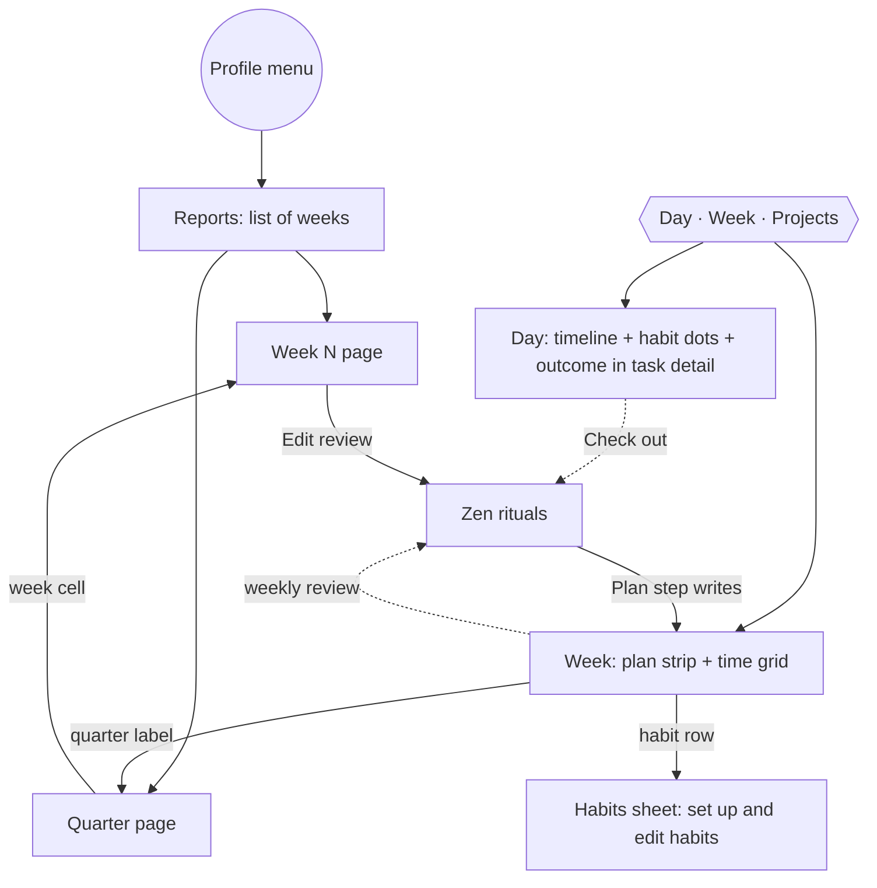

# Plan where you live, look back by period · spec

| Version | Date | Author | Change |
|---|---|---|---|
| 1.0 | 2026-11-02 | Jennifer | First spec. Founder approved the IA and all three decisions on 2026-11-02. Replaces spec-simple-shell §3.10 (Reports tabs) and finishes W-02 and A3 from that spec. |

**Bottom line:** move planning and daily logging out of Reports and into Day and Week, and rebuild Reports as a read-only archive by period: a list of weeks, a **Week N** page, and a **Quarter** page. Week becomes the founder's Notion week page: outcomes, quarter priorities, a habit row and project hours above the time grid. Almost all the data already exists. The backend change is one field; the rest is frontend work in 5 phases.

Evidence: founder decisions 2026-11-02; code read 2026-11-02. `[secondary: <file>]` cites a research file in `../../research/`, dated 2026-10-23 or 2026-11-01 as in its file name; research in `research/2026-10-23-*` and `research/2026-11-01-*`, plus `IMPROVEMENTS.md`, `OPEN-LOOPS.md`, `REEVALUATION-SUNSAMA.md`. Research grades: A meta-analysis/RCT · B single study · C practitioner · D anecdote.

## 1. Problem: the weekly plan and daily habits sit in the look-back area

Observed in the current build [primary: code read, 2026-11-02]:

| # | Problem | Where |
|---|---|---|
| P1 | This week's outcomes and quarter planning are only in Reports → Reviews and inside the review flow. Week shows only the time grid. | `ReviewHome.tsx`, `WeekView.tsx` |
| P2 | Day no longer logs habits. Spec-simple-shell A3 put it there; the calm-canvas rebuild dropped it. Habits are logged in Reports → Habits or in a ritual step. | `DayCanvas.tsx`, `HabitsPage.tsx` |
| P3 | Reports is split by data type (Time, Habits, Reviews). The founder's real question is "how was week 44?", which needs all three. The Notion week page answers it today, by hand. | `ReportsPage.tsx` |
| P4 | Per-project weekly hours (W-02) are only on the project page, never next to the week being planned. | `ProjectBrief.tsx` |
| P5 | `habits sync` (ActivityWatch auto logs) runs from the Habits page. If that page goes away, auto logs stop updating. | `useHabitSync` |

**Who gains:** the founder first. Their success test is to stop opening Notion and Clockify for 2 weeks [primary: IMPROVEMENTS.md §6]. Their Notion week page holds weekly priorities, a 7-day O/X habit grid, the 3 reflection questions and Focused Time hours copied by hand from Clockify. One week was recorded as 40 h when Clockify said 42 h 11 m [primary: founder screenshots, 2026-10-23]. After the founder, the beachhead: anyone who plans weekly outcomes.

## 2. Principles

1. **Plan in the time span you're living in.** Today's actions go on Day, this week's plan on Week. Reports never asks you to plan.
2. **Look back by period, not by data type.** One page per week and per quarter holds time, habits, outcomes and notes together.
3. **Rituals are the only bridges between periods.** Morning → today, Check out → tomorrow, Weekly review → next week, Quarter wrap-up → next quarter.
4. **Felt before data.** The most recent unreviewed week shows its numbers only after its review's Feel step [secondary: perception gap, spec v1 REQ-REV-01, grade A].
5. **One insight, one action, or nothing.** A page that is only a chart gets read twice and dropped [secondary: why-planners-fail #19–20, grade B; only 28% opened a retrospective view daily].
6. **Fractions, never grades.** "4.5 / 6 h", "5 of 6 days". No streaks, scores, percentages or red counts [secondary: why-planners-fail #10–11, grade B; usable-flow-synthesis §5].

## 3. Information architecture

| Thing | Plan / do | Look back |
|---|---|---|
| Today's tasks and blocks | Day | Week N → Days |
| Habits | Log on Day (dots) and in Check out; set up from Week's habit row | Week N → Habits |
| Weekly outcomes | Week strip; weekly review Plan step | Week N → Outcomes |
| Quarter priorities | Week strip quarter line; weekly review Quarter step | Quarter page |
| Project hours | Week strip project row | Week N → Time |
| Time entries | Timer; Week grid tracked strip | Week N → Time entries (editable, see RP-08) |
| Reflection | Check out note; weekly review One change | Week N → Days, Notes |

Routes after the change:

| Route | Status |
|---|---|
| `/?view=day\|week&week=` | Kept |
| `/reports` | Redirects to `/reports/weeks` |
| `/reports/weeks` | **New.** List of weeks grouped by quarter |
| `/reports/week/$week` | **New.** Week N page (`$week` = Monday date key) |
| `/reports/quarter/$week` | **New.** The quarter that contains `$week` |
| `/reports/reviews`, `/reports/time`, `/reports/habits`, `/time`, `/habits`, `/review` | Redirect: reviews → weeks; time and habits → `/reports/week/<this Monday − 7>` |
| `/review/$week` | Kept (weekly review flow) |

## 4. Requirements

### 4.1 Week: the plan strip (W)

The strip sits between the Week header and `ScheduleView`. It has at most four rows. Rows with nothing to show don't render.

| ID | Requirement | Acceptance criteria |
|---|---|---|
| W-10 | **Quarter line** in the Week header meta: "Q4 · Week 7 of 13" and the priority titles. With no quarter covering the week: "Plan a quarter" opens `QuarterSetup` in a popover. | Clicking the label opens `/reports/quarter/$week`. Priority titles can be edited from a popover with the existing `useUpdatePriority`. The 3-priority cap is still enforced by the backend (`MAX_PRIORITIES`). |
| W-11 | **Outcomes row:** the week's open, achieved and carried outcomes (dropped hidden). Each shows title, linked tasks done/total, tracked hours, and the quarter priority it serves. | Add, rename and remove work inline. The backend caps (`MAX_OPEN_OUTCOMES` = 3, `MAX_CARRIES` = 2) surface as their existing error text. Empty state: one line, "Up to 3 outcomes, each a finished result." |
| W-12 | Outcome progress is a fraction, plus a thin bar for linked tasks done/total. Never a percentage [secondary: multi-project-overload, ρ = .43, search snippet only]. | No `%` character renders in the strip. |
| W-13 | **Habit row:** collapsed by default, one line of 7 day marks (Mon–Sun), each showing "done / due" for that day. Expanded, it shows one line per habit with 7 `HabitCell`s and "x of last 14" at the end. | Collapse state persists in `preferences.ts` (`weekHabitsOpen`). Cells are editable for past days and today, and read-only for future days. Planned skip days show as rest, not as misses. |
| W-14 | The habit row has an **Edit habits** button that opens a right-side **Habits sheet**: active habits with Edit and Archive, plus **New habit** (`HabitDialog`). The ActivityWatch sync notice (`SyncNotice`) moves here. | Every action available today on `HabitsPage` is reachable from the sheet. The sheet opens with no habits and shows the "No habits yet" empty state with New habit. |
| W-15 | **Project row (finishes W-02):** each active project or area with `weekly_minutes` set shows "Name tracked / target h" plus planned block hours as a lighter bar. | Tracked comes from time entries in the week; planned from blocks linked to the project's tasks. Paused, done and dropped projects are excluded. No red: over-target uses the same colour [secondary: personal-project-management §4, grade C]. |
| W-16 | Monday to Wednesday, if last week is unreviewed and has activity, the strip shows one neutral line: "Week 44 isn't reviewed · Review (about 10 min)". | The line opens the weekly ritual. It's hidden once `reviewed_at` is set or after Wednesday [secondary: rituals-and-recovery §3, grade C]. |

### 4.2 Day (D)

| ID | Requirement | Acceptance criteria |
|---|---|---|
| D-10 | Under the date line, one small dot per habit due today, in time-of-day order. Click toggles done for yes/no habits; for counted habits (times or minutes) it opens the same control `HabitCell` uses. | Status matches `listHabitDays` for today. Hidden when no habit is due. Quit habits show as one dot for "clean today" and default to clean. |
| D-11 | The task detail (`Focus`) shows "Serves: <outcome>" with `OutcomePicker` to change it. | Shown when this or next week has outcomes, the same rule as REQ-OL-02. |
| D-12 | `syncHabits` runs on app start, on window focus (at most every 5 min) and when the Habits sheet opens, instead of on the Habits page mount. | Auto logs update without opening any habits screen. Unit-test the throttle. |

### 4.3 Reports (RP)

| ID | Requirement | Acceptance criteria |
|---|---|---|
| RP-10 | `/reports/weeks` lists past weeks, newest first, grouped under quarter headings that link to the Quarter page. Each row shows Week N, date range, felt, outcomes achieved/total, tracked hours, and "Reviewed" or "Not reviewed". | The current week is not listed; one line at the top reads "This week is in Week" and links there. Weeks with no activity (no entries, outcomes or completed tasks) collapse into "n quiet weeks". "Not reviewed" uses the muted text colour with no icon or colour change [secondary: rituals-and-recovery §3, grade C]. |
| RP-11 | The Week N page sections, in this order: header (Week N, dates, felt, reviewed state, **Edit review**) → insight line (RP-13) → focused hours (tracked and planned totals) → Outcomes with evidence, plus "Also finished" → Time by project (top 3 plus "Other") → Habits (read-only 7-day grid, "x of y due days" for that week) → Days (7 lines: felt and the check-out note) → Notes (worked, fell short, one change). | Every number matches its source query for that Monday–Sunday. Empty sections don't render. |
| RP-12 | If the page is for the **most recent unreviewed week**, only the header and a "Review week N · about 10 min" card render. Data appears once `reviewed_at` is set, or from that week's next Wednesday onward, marked "Not reviewed". | Covers principle 4. Test: an unreviewed last week on a Monday shows no hours, outcomes or habits. |
| RP-13 | **Insight line:** at most one sentence, chosen by a pure function `pickInsight(week)` in `features/reports/insight.ts` from the rules in §4.4. It may end with one action link. | No LLM. Unit tests for each rule and for "no insight". If no rule fires, nothing renders. |
| RP-14 | The Quarter page shows label, "Week x of 13", the priorities with achieved-outcome count and wrap-up note, and 13 week cells. Each cell has a tracked-hours bar plus outcomes achieved/total and a reviewed mark. A cell opens its Week N page. Prev/next quarter links. | Read-only. The 13 bars match the founder's Notion Focused Time column [primary: IMPROVEMENTS.md §6.1]. This reverses REQ-Q-03's "hours only in the tooltip", because the founder's weekly headline is hours. |
| RP-15 | Backend: `WeekSummary` gains `tracked_seconds` (sum of time entries Monday–Sunday) and `planned_seconds` (sum of blocks). | `cargo test` covers a week with entries crossing midnight Sunday→Monday (split by `started_at`). Bindings regenerate. |
| RP-16 | The Profile menu's "Reports" item and `Mod+4` open `/reports/weeks`. The tab bar in `ReportsPage` is removed. Reports gets a back link to Day. | No `<nav aria-label="Reports">` remains. |
| RP-17 | Time entries for the week are listed under a collapsed "Entries" disclosure at the bottom of Week N. Each row opens `EntryDialog` for editing. | This is the one allowed write on Reports: it fixes data, it doesn't plan. Add-entry stays in the timer. |

### 4.4 Insight rules (in priority order; the first that fires wins)

| # | Fires when | Sentence | Action link | Source |
|---|---|---|---|---|
| I-1 | An open or carried outcome has 0 tracked time while one project took ≥50% of tracked time | "Most of the week went to {project}; {outcome} got no time." | "Block time for it" → Week view of the next week | Deadline pull [secondary: Schmidt & DeShon 2007 via multi-project-overload, grade B] |
| I-2 | Planned ≥ 1.25 × tracked and planned ≥ 5 h | "Planned {p} h, tracked {t} h." | "Plan fewer blocks" → next week | why-planners-fail #20, grade B |
| I-3 | A build habit was done on fewer than half its due days | "{habit}: {x} of {y} days." | "Make it smaller" → Habits sheet, that habit | why-planners-fail #10–11, grade B |
| I-4 | Every outcome achieved | "All {n} outcomes done." | none | progress over volume [secondary: Amabile, via high-performer-practices, grade B] |

The copy is a placeholder until Vanessa reviews it. Never compare to other people, never use "only" or "failed".

### 4.5 Removed

| ID | Remove | Acceptance criteria |
|---|---|---|
| X-01 | `ReviewHome.tsx`, `TimePage.tsx`, `HabitsPage.tsx` and the `ReportsPage` tabs. Reusable parts (`QuarterPanel` pieces, `ProjectTimeBreakdown`, `WeekGrid`, `SyncNotice`, `EntryRow`) move to where they're used. | `pnpm lint` reports no unused exports. Old routes redirect (§3). |
| X-02 | `AGENTS.md`'s route list is updated to §3. | — |

## 5. Rejected alternatives

| Alternative | Why not |
|---|---|
| Keep Reports tabs and add a Week N tab | Still splits one week across three places (P3). |
| A separate "Plan week" screen (Sunsama-style) | Week already holds the grid and task rail. The strip plus the grid is that screen, so no new surface is needed [REEVALUATION-SUNSAMA §2 asks for the function, not a separate route]. |
| Outcomes always visible on Day | Conflicts with the calm canvas (minimal info at a time). Kept in task detail; see Q1. |
| Habits as their own top-level space | Habits go inside existing rhythms, not new screens [IMPROVEMENTS.md §6.2]. |
| An LLM-written weekly summary | Rejected 2026-10-23 (ideas journal). Deterministic rules are cheaper and testable. |

## 6. Build plan

Each task fits one agent context, names its files, and ends with `pnpm compile && pnpm lint && pnpm test` and `cargo test && cargo clippy --all-targets` passing.

| Phase | Task | Scope | Depends on |
|---|---|---|---|
| 1 Data | 1.1 | RP-15 in `review.rs` plus tests | — |
| 2 Week | 2.1 | Plan strip shell, W-10, W-11, W-12, W-16 (reuse `OutcomePlanner`, `QuarterSetup`) | — |
| | 2.2 | W-13 habit row, W-14 Habits sheet | 2.1 |
| | 2.3 | W-15 project row | 2.1 |
| 3 Day | 3.1 | D-10, D-11, D-12 | 2.2 |
| 4 Reports | 4.1 | Routes and redirects, RP-10, RP-16 | 1.1 |
| | 4.2 | RP-11, RP-12, RP-17 Week N page | 4.1 |
| | 4.3 | RP-14 Quarter page | 4.1 |
| | 4.4 | RP-13 insight function, tests and render | 4.2 |
| 5 Wrap | 5.1 | X-01, X-02 | all |

Phases 2 and 4 can run in parallel once 1.1 is merged. Rebecca's design pass on the strip and the Week N page comes before 2.1 and 4.2 if the founder wants polish first; otherwise build with current tokens and restyle later.

## 7. How we'll know

No telemetry exists [measured: config.md]. Founder use over weeks 45–47 [assumption: 3 weeks is enough to see habit and review patterns]:

| Measure | Target | How |
|---|---|---|
| Notion week page and Clockify not opened | 2 weeks in a row | Founder self-report |
| Habits logged from Day or Check out | ≥5 of 7 days | `habit_log` rows with `source = 'manual'` by date |
| Weekly review finished | 3 weeks in 3 | `week.reviewed_at` |
| Reports opened | ≥1 time a week, mostly Week N | Founder self-report |
| Outcomes edited outside the review | Observe only | Tells us whether the strip or the ritual is the real planning place |

Guardrail: if the strip makes Week feel busy (founder says so, or keeps the habit row collapsed and never opens it), cut the project row first.

## 8. Design notes for Rebecca

- The strip is the riskiest surface for the calm canvas: four rows over a time grid. Type and spacing on the sky backdrop, no boxes (memory: calm-canvas-direction). Collapsed rows read as one quiet line each.
- Week N is a page you read, like a journal entry, not a dashboard. Felt and the insight sentence come first; numbers come after.
- Unreviewed and not-yet states must look neutral, never like warnings.
- `.design/DESIGN.md` still describes the departure-board look and green chrome. It needs updating to the calm-canvas direction before this pass.

## 9. Open questions (each has a default; answer only to change it)

| # | Question | Owner | Default |
|---|---|---|---|
| Q1 | Show "2 of 3 outcomes moving" as one quiet line on Day? Research favours showing progress in the planner [secondary: why-planners-fail #11, grade B/C]. | Founder | No; revisit if outcomes get no linked tasks by mid-week |
| Q2 | Midpoint check at quarter week 6–7 ("on track / at risk / drop") as a weekly review step? | Founder | Later; not in this spec |
| Q3 | Missed review after Wednesday: offer a 2-minute review (feel + outcomes only)? | Founder | Later; W-16 just hides the line |
| Q4 | Share card or export for Week N (REQ-REV-07)? | Founder | Out of scope |

## 10. Out of scope

- Agent-session data in Week N (OPEN-LOOPS track).
- Passive capture and "untracked" time: there is no capture yet.
- Streaks, scores and comparisons with other people (never).
- Gantt, project health or RAG status, milestones [secondary: personal-project-management, grade C].

## 11. Risks

| Risk | Signal | Response |
|---|---|---|
| Week strip crowds the grid on small windows | Grid shows fewer than 8 hours at 900 px height | Collapse habit and project rows by default; outcomes row stays |
| Reports becomes an archive nobody opens | Founder opens it less than weekly | Link the Week N page from the review's Done step and the Check out on Mondays |
| Habit auto-sync breaks when the page is removed | Auto logs stop updating | D-12 lands in the same phase as the Habits sheet; test with ActivityWatch running |
| Insight rules feel judgmental | Founder dismisses or dislikes the line | Vanessa rewrites the copy; drop I-2 first |
