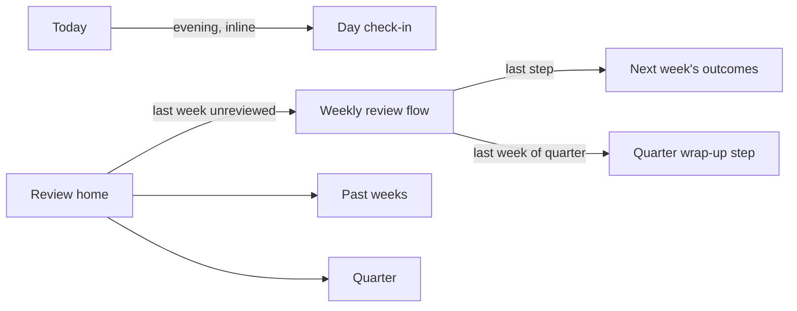

# Review redesign · spec

| Version | Date | Author | Change |
|---|---|---|---|
| 1.1 | 2026-11-01 | Jennifer | Built. Open questions resolved with their defaults; Planner's "Close today" button also removed. |
| 1.0 | 2026-11-01 | Jennifer | Replaces the Review tab, Close day and the quarter dialog. Founder decisions: tasks link to outcomes; full scope; no "Close day" concept. |

**Bottom line:** turn Review from a dashboard into three short rituals with a clear start and finish: an optional daily check-in on Today, a guided weekly review that ends by planning next week, and a quarter view built from weekly outcomes. Tasks link to outcomes so "achieved" shows evidence.

## 1. Problem

Observed in the current build [primary: founder use + code read, 2026-11-01]:

| # | Problem | Where |
|---|---|---|
| P1 | One screen holds quarter chart, outcomes, day table, time, 4 notes. No order, no finish, no "reviewed" state. | `ReviewPage.tsx` |
| P2 | This week's outcomes are set and judged on the same screen; planning next week means finding the week switcher. | Outcomes |
| P3 | "Achieved" is a toggle with no evidence. Tasks can't link to outcomes. Conflicts with spec v1 §3 "agent and human work counts only when verified". | `outcome` table |
| P4 | "Close day" is a button in a table row of the weekly page, behind a modal. Founder: "so unintuitive". | `DaysLedger`, `CloseDayDialog` |
| P5 | Review opens on the current, unfinished week. On Monday the useful week is last week. | route default |
| P6 | "1% improvement" duplicates "One change for next week"; notes autosave silently on blur. | `Notes` |

**Who gains:** anyone who plans weekly outcomes, the beachhead first. The v1 North Star is "finished a weekly review with ≥1 verified outcome" (spec v1 §10); today "finished" cannot be defined and "verified" cannot be shown, so the metric cannot be measured.

## 2. Principles

1. **One ritual, one flow.** Each ritual has a start, steps in a fixed order, and a done state.
2. **Felt before data** (spec v1 §7.1): ratings are asked before any numbers are shown.
3. **Review ends in a plan.** The weekly review's last step sets next week's outcomes.
4. **Nothing to "close".** Days end by themselves. The daily check-in is optional, inline and never blocks anything.
5. **Evidence, not toggles.** An outcome shows its linked tasks before the user judges it.

## 3. Information architecture

## 4. Requirements

### 4.1 Outcome ↔ task link

| ID | Requirement | Acceptance criteria |
|---|---|---|
| REQ-OL-01 | A task has an optional `outcome_id`. | Migration `005` adds `task.outcome_id REFERENCES outcome(id) ON DELETE SET NULL`. Sub-tasks inherit the parent's outcome, the same rule as project and section. |
| REQ-OL-02 | The task editor has an "Outcome" field listing this week's and next week's open outcomes. | Choosing one saves immediately; "None" clears it. Hidden when neither week has outcomes. |
| REQ-OL-03 | Each outcome shows its evidence: linked tasks done/total and tracked time on linked tasks in that week. | Numbers match the task list and time entries for that week. |
| REQ-OL-04 | Carrying an outcome over to next week moves its open linked tasks with it. | Done tasks stay linked to the old outcome. |

### 4.2 Day check-in (replaces Close day)

| ID | Requirement | Acceptance criteria |
|---|---|---|
| REQ-DC-01 | Today shows one inline row at the bottom: "How did today feel?" with 5 choices. | Appears from 17:00 local time or once the last planned block has ended, whichever comes first. No modal, no "close" wording. |
| REQ-DC-02 | After a rating, the row expands to show tasks done, planned and tracked time, and one optional note field. | The note saves on Enter and on blur, with a visible "Saved" state. |
| REQ-DC-03 | Until noon the next day, Today shows the same row for yesterday if it has no rating. | Can be dismissed with "Skip". Skip is stored and the row does not return for that day. |
| REQ-DC-04 | Remove `CloseDayDialog` and every "Close day" entry point. | No string "Close day" remains in the UI. Existing `day` rows are kept and shown in the weekly review. |

### 4.3 Review home (`/review`)

| ID | Requirement | Acceptance criteria |
|---|---|---|
| REQ-RH-01 | The top card has one state. Last week unreviewed: "Week 44 is ready to review · about 5 min" plus **Start review**. Otherwise: this week's outcomes with evidence and "Next review: Monday". | A partially done review shows **Resume review** with the step reached. |
| REQ-RH-02 | A list of past weeks: dates, reviewed mark, felt rating, outcomes achieved/total. | Clicking a reviewed week opens its read-only summary with **Edit review**. Clicking an unreviewed week starts its review. |
| REQ-RH-03 | A quarter panel (§4.5). | Shown below the top card on every visit. |
| REQ-RH-04 | The page no longer has a week switcher, a days table, note fields or an outcome form. | Those move into the flow (§4.4). |

### 4.4 Weekly review flow (`/review/$week`)

A full page with a step indicator. Every step saves when the user leaves it; leaving the flow and returning resumes at the same step.

| Step | Content | Acceptance criteria |
|---|---|---|
| 1. Feel | "How did the week feel?" 1–5. | No numbers are visible until it is answered. |
| 2. Outcomes | Each outcome with evidence (REQ-OL-03) and three choices: **Achieved**, **Not yet** (carry to next week), **Dropped**. Below: "Also finished", meaning done tasks not linked to any outcome. | Next is enabled once every outcome has a choice. A week with no outcomes shows one line and skips the choices. |
| 3. The week | Read-only: per day planned vs tracked, day ratings and notes from check-ins, habits met, time by project. | No inputs on this step. |
| 4. Reflect | Three prompts: What worked · What fell short, and why · One change for next week. Last week's "one change" is shown above as a reminder. | Optional. Migration copies `improvement` into `change` where `change` is empty, then the UI stops using `improvement`. |
| 5. Plan next week | "Not yet" outcomes appear pre-filled. Add up to 3 outcomes in total, each optionally serving a quarter priority. | The 3-outcome cap is enforced (spec v1 REQ-PLAN-01). |
| 6. Done | Summary: felt, outcomes achieved/total, next week's outcomes. | Sets `week.reviewed_at`. The home card switches state. |

Last week of a quarter: a **Quarter wrap-up** step appears between 5 and 6 (§4.5).

Data: migration `005` adds `week.felt INTEGER CHECK (felt BETWEEN 1 AND 5)`, `week.reviewed_at INTEGER`, `week.step INTEGER NOT NULL DEFAULT 0`, `outcome.status` gains `carried`, and `day.skipped INTEGER NOT NULL DEFAULT 0`.

### 4.5 Quarter

| ID | Requirement | Acceptance criteria |
|---|---|---|
| REQ-Q-01 | With no quarter covering this week, the panel says "Plan a quarter: up to 3 priorities for the next 13 weeks" plus **Plan quarter**. | The label defaults to e.g. "2026 Q4", and the start defaults to this week's Monday. |
| REQ-Q-02 | Planning is inline in the panel, not a modal: label, start week, up to 3 priorities. | Priorities can be edited and removed inline later. |
| REQ-Q-03 | The panel shows 13 week cells. Each shows outcomes achieved/total and a reviewed mark; the current week is highlighted; clicking a cell opens that week (REQ-RH-02). | Tracked hours move into the cell's tooltip. They are no longer the bar height. |
| REQ-Q-04 | Each priority shows the count of achieved outcomes that served it. | Count equals the outcomes with that `priority_id` and status `achieved` inside the quarter's 13 weeks. |
| REQ-Q-05 | Quarter wrap-up step: per priority, achieved outcomes and one optional note; then **Plan next quarter** opens REQ-Q-02 pre-filled with unfinished priorities. | Migration adds `priority.note TEXT NOT NULL DEFAULT ''`. |
| REQ-Q-06 | Remove `QuarterDialog`. | No modal remains for quarter editing; existing quarters and priorities keep their data. |

## 5. Open questions

| Question | Owner | Default if unanswered |
|---|---|---|
| Does "Not yet" create a new outcome next week, or move the same row? | Founder | New row with the same title, marked `carried` on the old week; open linked tasks move to the new row. |
| Does the evening row need a configurable time (default 17:00)? | Founder | No: 17:00 or the end of the last block. Revisit if check-ins stay rare. |

## 6. Out of scope

- Agent verdicts and the Review inbox (spec v1 §7). Not built yet; the flow leaves room for a step.
- Notifications or OS reminders for the check-in. The inline row comes first; add a reminder only if check-ins stay rare.
- Sharing or exporting a review (REQ-REV-07).

## 7. How we'll know

No telemetry exists [measured: config.md], so judge by founder use for 3 weeks [assumption]:

- Every week from 45 to 47 reaches "Done" by Tuesday.
- At least 4 of 7 days per week have a check-in rating.
- At least 2 of 3 outcomes per week have ≥1 linked task.

## 8. Risks

| Risk | Signal | Response |
|---|---|---|
| The 6-step flow feels long | Reviews abandoned at step 3–4 (`week.step` stalls) | Merge steps 3 and 4 |
| Linking tasks is a chore | Outcomes with 0 linked tasks | Offer a link from step 2 ("Link tasks") and from quick add (`+outcome`) |
| The evening row reads as nagging | Most days skipped | Show it only after the last planned block ends |
