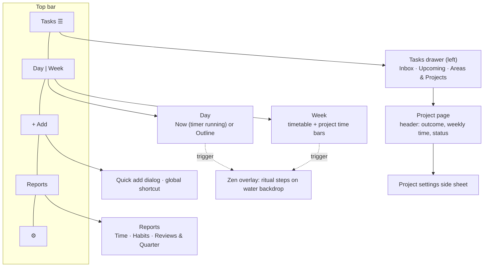

# Simple shell, rituals and zen mode · spec

| Version | Date | Author | Change |
|---|---|---|---|
| 1.0 | 2026-11-01 | Jennifer | First plan. Founder decisions from 2026-11-01 (PRODUCT.md). Awaiting approval before build. |

**Bottom line:** replace the sidebar app with one main screen (Day | Week toggle), a Tasks drawer, a Reports page and quick add. Planning and review move into configurable **rituals** that run in a calm full-window **zen mode** with a WebGL water backdrop. Projects gain two kinds and six settings. Labels are removed. The work comes in 8 phases; each phase, and each task inside it, leaves the app working.

Evidence: `research/2026-11-01-usable-flow-synthesis.md`, `-configurable-rituals.md`, `-personal-project-management.md`, `-zen-water-shader-feasibility.md`.

## 1. Decisions

| # | Decision | Source |
|---|---|---|
| D1 | Main page = Day / Week toggle, top centre. Day shows the running task (timer on) or today's outline. Week shows the timetable | founder |
| D2 | Time, Habits and Review fold into one **Reports** page (full page, calm visual, no "corporate dashboard" look) | founder |
| D3 | Projects open from a button. Each project has its own configuration | founder + research |
| D4 | Future tasks are added from a separate button or panel, not the main screen | founder |
| D5 | Labels are removed entirely (UI, quick add `@label`, tables) | founder |
| D6 | Zen mode with the full WebGL water shader, built in small steps | founder |
| D7 | Review becomes configurable rituals: morning, evening, wind-down, weekly, and after each work session | founder + research |

Defaults I chose, which you can overturn in one line each:

| # | Default | Why |
|---|---|---|
| A1 | **The Tasks drawer holds Inbox, Upcoming and the project tree.** One left button replaces both "Projects" and "add future tasks". Clicking a project opens it as a full page; its settings open in a side sheet | Research: quick settings fit a side sheet, but the long task list needs a page. One drawer instead of two buttons keeps the shell simple |
| A2 | **Zen mode is an in-app overlay** that covers the whole window, not OS fullscreen | Works on every platform, can't trap the user, and Esc always exits |
| A3 | **Habits are logged in the Day outline and set up in Reports → Habits** | Daily action belongs on Day; setup is rare |
| A4 | **Weekly review runs inside zen mode** and reuses the existing `/review/$week` steps | Avoids rebuilding the flow |
| A5 | **First run asks one question: "When do you plan your day? Morning / Evening"** and turns on that ritual. Session close and weekly review are on for everyone | Research: no evidence for one best time; a morning-only default suits the people who need it least |

## 2. Information architecture

Routes after the change:

| Route | Status |
|---|---|
| `/` | **Main** (`?view=day\|week&week=`) replaces `/today` and `/planner` |
| `/projects/$projectId` | Kept, rendered beside the drawer |
| `/inbox`, `/upcoming` | Kept as drawer lists (deep links still work) |
| `/reports/time`, `/reports/habits`, `/reports/reviews` | New; replace `/time`, `/habits`, `/review` |
| `/review/$week` | Kept as a route and also hosted in zen mode |
| `/labels/$labelId` | **Removed** |

## 3. Requirements

### 3.1 Shell (S)

| ID | Requirement | Acceptance criteria |
|---|---|---|
| S-01 | `AppShell` has a top bar: Tasks (left), Day/Week segmented toggle (centre), + Add, Reports, Settings (right). No permanent sidebar | No `<nav aria-label="Main">` sidebar renders. Toggle state is in the URL (`view`) |
| S-02 | The Tasks drawer slides in from the left over the main view, holding Inbox, Upcoming and the project tree (Areas, then their Projects) | Opens with the button or `G T`. Esc closes it. Clicking a project navigates to `/projects/$id` and closes the drawer |
| S-03 | + Add opens the existing quick-add parser in a dialog; the global shortcut `Q` also works | A task is saved within one Enter. Default destination is Inbox unless parsed otherwise |
| S-04 | The running timer shows as a small pill in the top bar on every route except Day/Now | Clicking it goes to Day |
| S-05 | `SearchDialog` (⌘K) remains and lists every route above | — |

### 3.2 Day view (D)

| ID | Requirement | Acceptance criteria |
|---|---|---|
| D-01 | **Now state** when a timer runs: task title, project, elapsed time, the block it belongs to with time left, Stop, and the task's `next_step` note if set | Appears within 1 s of timer start; Stop returns to the Outline |
| D-02 | **Outline state** otherwise, in one column ordered by time: this week's ≤3 outcomes (top strip) → today's time blocks interleaved with unblocked due tasks → today's habits (tap to log) → one next action per Active project (collapsed strip) | No section renders when empty. Clicking a task or block starts the timer for it |
| D-03 | Overdue tasks are not shown in red on top. If any exist, one neutral line reads "N from earlier · Sort out" and opens the leftovers step | No `text-p1` overdue header remains |
| D-04 | If today has no plan (no blocks and no musts) and the planning ritual was skipped, the Outline shows a "Plan today · 2 min" card that starts the morning ritual | Shown once per day; dismissible |
| D-05 | Each task shows "moved ×N" when its rollover count N ≥ 2 | Count matches `task.rollover_count` |

### 3.3 Week view (W)

| ID | Requirement | Acceptance criteria |
|---|---|---|
| W-01 | Week view renders the existing `ScheduleView` (drag to create, move and resize blocks) and the task rail | Feature parity with `/planner` today |
| W-02 | A strip above the grid shows each Active project or area with a weekly time target: "CLIP 4.5 / 6 h" (tracked / target), plus planned block hours as a lighter bar | Fractions only, never a % grade or red colour |

### 3.4 Rituals and zen mode (R)

Model: **Ritual = kind + enabled + one trigger + ordered steps from a closed library.**

| Kind (template) | Default steps | Default trigger | Target time | Default on? |
|---|---|---|---|---|
| Morning start | feel → leftovers → pick_musts → timeblock(today) | first app open of the day | 2–5 min | if A5 = Morning |
| Evening shutdown | what_moved → leftovers → pick_musts(tomorrow) → timeblock(tomorrow) → one_line_note | at time, default 17:30, or after the last block, whichever is first | 3–7 min | if A5 = Evening |
| Wind-down | brain_dump → habit_check → device_away | bedtime minus 45 min | ≤5 min | off |
| Session close | did_it_move → next_step_note → breathing_pause (optional) | timer stop after ≥20 min | ≤60 s | on |
| Weekly review | existing review steps (§3.6) | first open on the chosen review day (default Monday) | ~10 min | on |

Step library (closed set): `feel`, `what_moved`, `leftovers`, `pick_musts`, `timeblock`, `one_line_note`, `habit_check`, `breathing_pause`, `next_step_note`, `did_it_move`, `brain_dump`, `device_away`, `weekly_review`.

| ID | Requirement | Acceptance criteria |
|---|---|---|
| R-01 | Table `ritual(id, kind UNIQUE, enabled, trigger_json, steps_json, last_run_at)` seeded with the 5 templates | Migration seeds 5 rows; `cargo test` covers the seed and the trigger evaluation |
| R-02 | Table `ritual_run(id, ritual_id, date, started_at, finished_at, skipped, step_reached)` | A run is resumable at `step_reached` |
| R-03 | Triggers: `first_open`, `at_time(HH:MM, weekdays)`, `after_last_block`, `after_timer_stop(min)`, `manual` | Evaluated on app focus and once a minute; at most one ritual opens at a time |
| R-04 | Zen overlay: full window, water backdrop, one step per screen, step dots, Back/Next, **Skip** always visible, Esc exits | Exit leaves a resumable run. The overlay never opens during an active timer, except Session close |
| R-05 | Snooze is fixed at 15 min, once. A skipped planning ritual folds into the next one: a skipped evening puts `leftovers` first in the next morning's card (D-04) | No nag notification exists |
| R-06 | Prompt text for `feel`, `one_line_note` and `what_moved` rotates from a fixed pool of ≥5 wordings | The same wording isn't shown two days running |
| R-07 | Settings → Rituals: per ritual on/off, trigger time and weekdays, step toggles and reorder (drag). **No** custom prompts, per-step timers, duplicates, streaks or snooze length | Uses `SettingRow` |
| R-08 | Wind-down always uses the dark theme with a slowed backdrop and ends on `device_away` | — |
| R-09 | Each step writes to existing tables: `feel`/`one_line_note` → `day`; `leftovers` → task date, someday or delete plus `rollover_count`; `pick_musts` → `task.must_on`; `timeblock` → `time_block`; `next_step_note` → `task.next_step`; `brain_dump` → Inbox tasks; `habit_check` → `habit_log` | Covered by Rust tests per command |

### 3.5 Zen backdrop (Z)

Follows the 10 steps in `research/2026-11-01-zen-water-shader-feasibility.md`. Hard rules:

| ID | Requirement | Acceptance criteria |
|---|---|---|
| Z-01 | A static CSS backdrop always renders underneath; the shader layers on top | Shader failure shows the static backdrop with no error UI |
| Z-02 | Raw WebGL2, no new dependency, 0.5× resolution, ≤30 fps, pauses when hidden, one still frame under reduced motion | Checked per step |
| Z-03 | Setting `zenBackdrop: auto \| shader \| static \| off`; in `auto`, a slow-GPU guard falls back to static | Unit test for the guard decision |
| Z-04 | No Shadertoy code (licence); the shader is original, based on public articles | Code review |

### 3.6 Review changes (V)

| ID | Requirement | Acceptance criteria |
|---|---|---|
| V-01 | Weekly steps: Feel → Outcomes (with plan vs tracked hours per outcome inline) → **Clear the deck** → One change → Plan → (Quarter) → Done. "The week" step is removed | `WeekReview.tsx` step list matches |
| V-02 | Clear the deck lists: Inbox items, tasks with `rollover_count ≥ 3` or overdue more than 14 days, and projects due for review (§3.7). Bulk actions: reschedule, someday, drop, and for projects continue / pause / close / drop | The list empties as items are handled |
| V-03 | An outcome carried twice needs one of: shrink (edit title), new date or drop. "Not yet" is disabled for it | Rust test on the carry chain length |
| V-04 | In the Plan step, each new outcome takes a first task and a day | Saving an outcome without them is allowed but shows "add a first step" |
| V-05 | Quarter wrap-up asks Keep / Change / Drop per priority; nothing is pre-filled | — |
| V-06 | The review label reads "about 10 min"; the review day is set in Settings → Rituals | — |

### 3.7 Projects (P)

| ID | Requirement | Acceptance criteria |
|---|---|---|
| P-01 | New columns on `project`: `kind` (project / area), `status` (active / paused / done / dropped), `outcome`, `weekly_minutes`, `target_date`, `kill_criteria`, `review_every_weeks` (default 1 for projects, 4 for areas), `last_reviewed_at`, `in_order` | Migration; existing projects become `area`, `active` [assumption: most current Todoist-style projects are ongoing] |
| P-02 | A Project may nest under an Area, not the reverse; depth stays ≤3 | Validation error otherwise |
| P-03 | Project page header: kind, outcome, weekly time bar, status, next review date, all editable inline | — |
| P-04 | The project settings side sheet holds the six settings plus colour, view and in-order | Replaces `ProjectDialog` |
| P-05 | Next action = first open task (or first by position if `in_order`); feeds D-02 | — |
| P-06 | Paused, done and dropped projects disappear from Day, Week and the drawer's main tree (shown under "Inactive") | — |

### 3.8 Habits (H)

| ID | Requirement | Acceptance criteria |
|---|---|---|
| H-01 | Replace `streak` with `consistency`: done days / due days over the last 14 | `habits.rs` streak code and the UI flame/count are removed |
| H-02 | `skip_days_per_week` (0–2, default 1): planned skips count as neither done nor missed | Rust tests |
| H-03 | Optional `anchor` text, "After I ___", shown on the habit row | — |
| H-04 | Pausing or retiring a habit shows "You ran this N weeks" | — |

### 3.9 Tasks (T)

| ID | Requirement | Acceptance criteria |
|---|---|---|
| T-01 | Remove labels: `labels.rs`, `LabelPage`, `@label` parsing, label UI; migration drops `task_label` and `label` | `grep -ri label` finds only UI-component uses; parse tests updated |
| T-02 | New columns: `rollover_count`, `someday` (bool), `next_step`, `must_on` (date) | Migration |
| T-03 | Someday tasks are hidden from Day, Week, Upcoming and overdue; they appear in a drawer list "Someday" | — |

### 3.10 Reports (RP)

| ID | Requirement | Acceptance criteria |
|---|---|---|
| RP-01 | `/reports` with three tabs: Time (from `TimePage`), Habits (from `HabitsPage`, including setup), Reviews (from `ReviewHome`: past weeks plus the quarter panel) | Old routes redirect |
| RP-02 | Every report section ends in one suggested action or none, never a bare chart | e.g. "Planned 22 h, tracked 14 h → plan 3 fewer blocks?" |
| RP-03 | A calm header uses the static zen backdrop (no shader) | Design pass later |

## 4. Build plan

Each task is sized to fit one agent context. It names its files and ends with `pnpm compile && pnpm lint && pnpm test` and `cargo test && cargo clippy --all-targets` green.

| Phase | Task | Scope | Depends on |
|---|---|---|---|
| **0 Data** | 0.1 | Migration 006: drop labels; task `rollover_count`, `someday`, `next_step`, `must_on`; project columns (P-01); habit `skip_days_per_week`, `anchor`; `ritual` and `ritual_run` tables with 5 seeded rows | — |
| | 0.2 | Remove label code (T-01) in Rust, bindings and frontend | 0.1 |
| | 0.3 | Rust commands and tests: rituals CRUD, `ritual_due(now)` evaluation, ritual runs, task triage commands (reschedule with rollover++, someday, must) | 0.1 |
| **1 Shell** | 1.1 | Top bar and route `/` with the Day/Week toggle; Week = current PlannerPage content; Day = current TodayPage temporarily; remove the sidebar | 0.2 |
| | 1.2 | Tasks drawer (Inbox, Upcoming, project tree, Someday) and the quick-add dialog with shortcut | 1.1 |
| | 1.3 | `/reports` with tabs reusing TimePage, HabitsPage and ReviewHome; redirects from the old routes | 1.1 |
| **2 Day** | 2.1 | Outline (D-02, D-03, D-05) | 1.1, 0.3 |
| | 2.2 | Now state (D-01) and the timer pill (S-04) | 2.1 |
| **3 Zen (static)** | 3.1 | Shader steps 1–2: static backdrop, `ZenOverlay` shell, `zenBackdrop` setting | 1.1 |
| | 3.2 | Ritual runner in the overlay: trigger polling, run state, Skip/Esc/snooze (R-03 to R-05) | 3.1, 0.3 |
| | 3.3 | Step components, part 1: feel, what_moved, leftovers, pick_musts, one_line_note | 3.2 |
| | 3.4 | Step components, part 2: timeblock (reuses `ScheduleView` day column), did_it_move, next_step_note, breathing_pause, brain_dump, habit_check, device_away | 3.3 |
| | 3.5 | Weekly review hosted in the overlay; V-01 to V-06 | 3.2 |
| | 3.6 | Settings → Rituals (R-07), the first-run question (A5), D-04 card, prompt rotation (R-06) | 3.4 |
| **4 Shader** | 4.1–4.8 | Shader steps 3–10 from the feasibility doc, **one task per step** | 3.1 |
| **5 Projects** | 5.1 | Project page header and settings side sheet (P-02 to P-04) | 0.1 |
| | 5.2 | Next action in Day (P-05), week time strip (W-02), Inactive grouping (P-06), projects in Clear the deck (V-02) | 5.1, 2.1, 3.5 |
| **6 Habits** | 6.1 | H-01 to H-04, habit check in Day | 0.1 |
| **7 Wrap** | 7.1 | Report suggestions (RP-02); update `AGENTS.md` (labels gone, new routes, rituals domain); remove dead code | all |

Phase 4 runs in parallel with Phases 5 and 6 once 3.1 is merged. The shader touches only `src/features/zen/`.

## 5. Success measures (own use first, then beta)

| Measure | Target | How |
|---|---|---|
| Planning ritual finished or folded into the next one | ≥5 days in 7 | `ritual_run` |
| Median planning ritual length | ≤5 min | `ritual_run` timestamps |
| Weekly review finished within 7 days | 3 weeks in 4 | `week.reviewed_at` |
| Overdue count right after a review | falls week on week | tasks |
| Session-close skip rate | <50% after week 2; if higher, the prompt is too costly | `ritual_run.skipped` |

## 6. Out of scope

- Custom ritual prompts, ritual streaks, push notifications, OS fullscreen
- Project templates, Gantt, milestones as an entity, project priority
- Visual polish beyond the water shader (Rebecca's design pass comes later)
- Agent-session features (separate track, OPEN-LOOPS.md)

## 7. Open questions (each has a default; answer only to change it)

| # | Question | Default |
|---|---|---|
| Q1 | One Tasks drawer, or separate Projects and Add buttons (A1)? | One drawer plus + Add |
| Q2 | Should existing projects migrate as Areas? | Yes; you re-mark finite ones |
| Q3 | Session close after every timer stop ≥20 min, or only after planned blocks? | ≥20 min, any stop |
| Q4 | Week starts Monday, review day Monday? | Yes, both configurable |

## 8. Risks

- **Linux GPU:** WebKitGTK can render WebGL2 slowly in software without an error. Mitigated by the static-first layering and the guard (Z-01, Z-03).
- **Zen mode reads as "Close day" again.** Mitigated by Skip and Esc everywhere, no blocking, and no nagging (R-04, R-05). Watch the skip rate.
- **Scope:** about 20 tasks. Phases 0–3 alone deliver the new daily experience with a static backdrop; stop there if needed.
