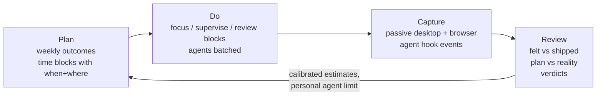
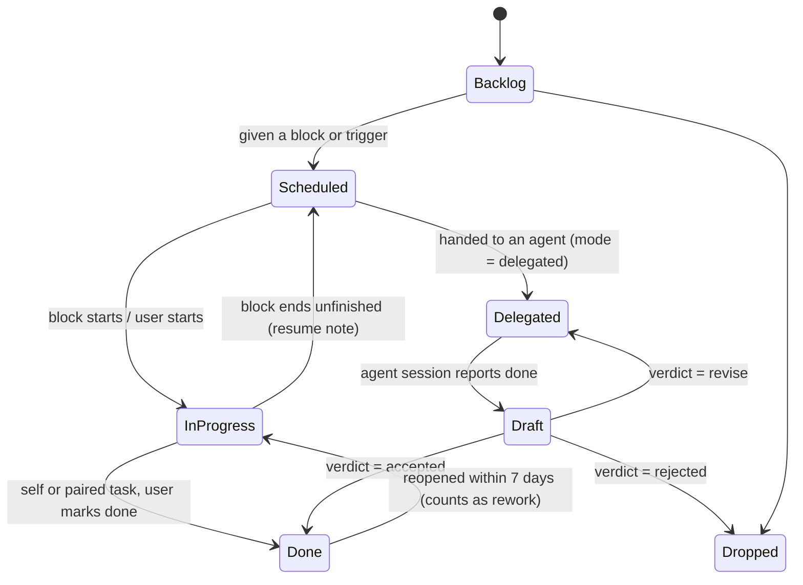

# skkil-time · Product specification v1.0

| Version | Date | Author | Change |
|---|---|---|---|
| 1.0 | 2026-10-23 | Jennifer | First complete spec. Merges the 10-18 tracker strategy and AI-builder addendum with tasks, time blocking and planning/review rituals. Supersedes the "Core loop" in `strategy-2026-10-18.md` §4. |

_Status: final for build planning; Phase 0 validation gates (§13) still apply before production code. Evidence: `../../research/2026-10-23-productivity-methods-evidence.md`, `../../research/2026-10-23-ai-productivity-illusion.md`, `../../research/2026-10-23-planner-competitor-landscape.md`, plus the two 10-18 scans._

## 1. Summary

**skkil-time is a planner that checks itself.** You plan your week as a few outcomes and your days as time blocks. The app captures what actually happened on your computer and in your AI agent sessions, without timers. Each day and week it shows the plan next to verified results. For AI-assisted solo builders, it answers the question no tool answers today: *"My agents were busy all day. Did I actually ship anything, and was my attention where I meant it to be?"*

- **Who:** AI-assisted solo builders and self-directed desk workers (desktop-first, Linux/macOS first).
- **Why now:** AI agents inflate activity faster than finished work, and people can't judge their own AI gains (§2). Planners now ship MCP servers, but none captures reality. Trackers capture reality but don't plan. Agent tools see only the agent.
- **How we'll know it worked:** users who finish a weekly review with at least one verified outcome, 4 weeks after install (§10).

## 2. Problem

### The founder's thesis, tested

The founder's starting thesis was: *"AI agents make people feel productive when in reality they did nothing but prompt."* The evidence supports a narrower version, and the product is built on that version:

| Part of the thesis | Verdict | Evidence |
|---|---|---|
| People can't tell whether AI made them productive | **Supported** | Developers were 19% slower with AI but believed they were 20% faster [secondary: METR RCT, 2025-07]. AI users overestimate their own performance, more so with higher AI literacy [secondary: Fernandes et al., Computers in Human Behavior, 2025] |
| Activity rises faster than finished work | **Supported** | Across 718 firms: code volume +30%, review/merge time +49%, issues resolved not significantly changed [secondary: Chen & Stratton working paper via Ars Technica, 2026-10] |
| Delegating without understanding costs skill | **Supported** | AI-assisted learners scored 50% vs 67% on a follow-up quiz with no significant speed gain. Those who asked for explanations scored 65-86%, those who fully delegated 24-39% [secondary: Anthropic RCT preprint, 2026-01] |
| Supervising many AI tools at once wears people out | **Supported, thinner** | 14% report "brain fry"; self-reported productivity falls at the 4th concurrent tool [secondary: BCG/HBR via Built In, 2026-03/06] |
| "They did nothing but prompt" | **False on average** | +26% completed tasks across 3 firms, n=4,867 [secondary: Cui et al., Management Science, 2025]; +15% in customer support [secondary: Brynjolfsson et al., QJE 2025] |

**Problem statement used in this spec:** AI gains are real but uneven. People can't tell which side of the line they're on, the numbers they see measure activity rather than outcomes, and delegating work they don't understand costs them skill and attention. The product should not be anti-AI. It should be an honest mirror.

### Why today's tools leave the gap open

| Tool type | Knows what you intended | Knows what happened | Sees agent work | Example |
|---|---|---|---|---|
| Task lists, ritual planners | Yes | No (Sunsama's "actual" is manual or timer-based) | No | Todoist, Sunsama, Akiflow, Morgen |
| Auto-schedulers | Partly (AI picks the plan) | No | No | Motion, Reclaim |
| Passive trackers | No | Yes | No | Rize, ActivityWatch |
| Agent dashboards | No | Agent only | Yes | Claude Code, Codex app, Cursor, Conductor |

No product found combines planning, passive capture and agent awareness [secondary: competitor scan of 18 products, 2026-10-23]. MCP support is now table stakes: Todoist, Sunsama, Akiflow, Amie, Notion, Rize and others ship official servers.

People do voice the "no single picture" problem: *"They all solve one piece of the puzzle but nothing tied it all together… at the end of the month I had no idea if I was actually making progress"* [anecdote: HN 47641840, 2026-04-04]. "No reality check" is a latent need, not a common app-store complaint (planned-vs-actual rarely appears in 710 1-2★ reviews) [secondary: App Store RSS scan, 2026-10]. Positioning has to make the need visible; it can't just answer a complaint.

## 3. Strategy kernel

**Diagnosis.** Planning tools know your intentions, trackers know your activity, and agent tools know your agents. Nothing joins them, so nobody can compare what they meant to do with what they verifiably finished. AI makes this worse: it increases activity, hides where attention went, and inflates how productive people feel.

**Guiding policy.** Be the honest mirror between intention and verified outcome, and protect single-task attention.
- Measure outcomes, never activity. Agent output counts only after a human verdict.
- The user makes the plan. Agents and AI may propose; they never decide what counts.
- Capture reality passively and locally. Never ask for a timer.
- Use only rituals with evidence behind them, kept short.

**What this rules out:** AI auto-scheduling of your day; an in-app AI assistant in v1 (bring your own AI through MCP instead); team or manager views; billable-client features; scoring the user against other people; leisure scheduling to the minute.

**Coherent actions.**
1. One loop (**Plan → Do → Capture → Review**) where each step feeds the next, so the weekly review is built from data, not memory.
2. Agent work is a first-class task state (delegated → draft → verdict), not a separate dashboard.
3. Focus blocks change behaviour in the moment: agent alerts are batched and concurrency is visible.
4. A local MCP server lets the user's own agents plan with the app and respect their focus, while only humans can verify outcomes.



## 4. Methods we build in, and the ones we don't

Every ritual in the product maps to evidence. The product does not market methods that lack it.

| Method | Evidence | How it shows up |
|---|---|---|
| If-then plans with a when and where | **A:** d = .65 over 94 tests [secondary: Gollwitzer & Sheeran 2006]. Writing date **and time** raised follow-through; date alone did not [secondary: Milkman et al., PNAS 2011] | Every Today task needs a block or trigger. Date-only tasks stay in the backlog (REQ-PLAN-04) |
| Recording and reporting progress | **A:** d = .40 over 138 RCTs, larger when progress is physically recorded or reported [secondary: Harkin et al. 2016] | Daily close and weekly review need active confirmation; optional share export (REQ-REV-07) |
| Specific, challenging goals | **A:** d = .34 [secondary: Epton et al. 2017] | Weekly outcomes must be phrased as a finished result, 3 at most (REQ-PLAN-01) |
| Planning fallacy | **A** phenomenon; fixes are **B**, mixed | Estimates show your own past actuals for similar tasks (REQ-PLAN-06); A/B test it |
| People pick urgent over important | **A:** replicated n = 2,374, attenuated with controls [secondary: Mills et al., JCR 2026-09] | Daily pick shows the weekly outcome next to the due date (REQ-PLAN-05) |
| Task-switch costs; a "ready-to-resume" note | **A** / **B** [secondary: Rubinstein 2001; Leroy & Glomb 2018] | One-line resume note when a block ends or is interrupted (REQ-DO-05) |
| Batching notifications | **A**, by analogy from phones: ~3×/day lowered stress [secondary: Fitz et al. 2019] | Agent "needs you" alerts held during focus blocks (REQ-DO-03) |
| Commit before seeing AI output | **A:** reduced blind agreement at no time cost [secondary: Fogliato et al. 2022]; generation effect d = .40 | Optional one-line "expected result" when delegating (REQ-AG-04) |
| Breaks | **A:** help fatigue (d ≈ .35), not output [secondary: Albulescu et al. 2022] | Optional break nudges, framed around energy |
| Scheduling leisure | **B:** makes leisure feel like work; rough scheduling avoids it [secondary: Tonietto & Malkoc 2016] | Personal blocks can only be rough (morning/afternoon/evening) (POL-PLAN-03) |

**Not built and not claimed:** Zeigarnik effect (a 2025 meta-analysis found no memory advantage), "21 days to a habit" (median 59-66 days, range 4-335), 90-minute ultradian blocks, Ivy Lee, GTD as a full system, or the shutdown ritual and Deep Work as proven methods. Time blocking itself has **no direct trial**; we use it because it carries the if-then mechanism, and we say so.

## 5. Non-goals

| Non-goal | Reason |
|---|---|
| AI auto-scheduling of the user's day | The plan has to be the user's own; unwanted AI is 16% of 1-2★ planner reviews [secondary: App Store scan, 2026-10-23] |
| In-app AI assistant in v1 | Users bring their own AI through MCP; no per-user model cost |
| Launching, orchestrating or hosting agents; worktrees; terminal UI | Crowded and platform-owned (Conductor, Claude Code, Codex app, Cursor) |
| Reading prompts, responses or transcripts | Privacy position; metadata is enough for every metric in §7.3 |
| Team, manager or employer views; leaderboards | Measuring individuals for evaluation breaks trust (POL-PRIV-05) |
| Client billing, invoicing, timesheets | Founder decision 2026-10-18; Toggl, Clockify and Rize own this |
| Phone-first blocking | Commoditized, and bypassable on iOS |
| Full GTD ontology (contexts, someday/maybe lists, tickler) | No independent evidence; adds setup overhead (8% of 1-2★ reviews [secondary: App Store scan, 2026-10-23]) |
| Exact-time scheduling of leisure | Makes leisure feel like work (Tonietto & Malkoc, B) |
| Web-chat (ChatGPT, Claude.ai) tracking in v1 | Depends on page structure that changes weekly |

## 6. Users and scenarios

**Beachhead:** AI-assisted solo builders (indie hackers, solo founders, freelance and remote developers) who run 1-4 coding-agent sessions on a typical day and plan their own time. **Second:** self-directed desk workers without agents (the 10-18 segment). **Later:** adults with ADHD, with care and no efficacy claims.

| ID | Scenario (job statement) |
|---|---|
| SCN-1 | When I plan Monday, I want to pick a few outcomes that matter and put them in my calendar, so the week isn't just a pile of tasks. |
| SCN-2 | When I'm in a focus block, I want my agents to stop pinging me and to know when I've drifted, so I finish one thing properly. |
| SCN-3 | When I hand a task to an agent, I want it tracked as delegated and not counted as done until I've reviewed it, so I know what actually shipped. |
| SCN-4 | When I stop work for the day, I want to see in 3 minutes how my day felt compared with what I actually finished, so I stop fooling myself. |
| SCN-5 | On Friday, I want a review built from data: outcomes, focus, agent yield, estimate accuracy. That way next week's plan is more realistic. |
| SCN-6 | When I'm working in Claude Code, I want the agent to read today's plan and add tasks to it, without leaving the terminal. |

Persona: "Min, the AI-assisted solo builder" [assumption: built from research themes; validate in Phase 0 interviews].

## 7. Solution overview

### 7.1 Core objects

| Object | Key fields | Notes |
|---|---|---|
| **Outcome** | title (finished-result phrasing), week, status (open / achieved / dropped), reflection note | 3 per week at most |
| **Task** | title, outcome link (optional), estimate (min), **mode** (self / delegated / paired), when (block id or trigger text), where/context, status, resume note, expected-result note | Mode decides which states apply (7.2) |
| **Block** | start, end, **type** (focus / supervise / review / shallow / personal-rough), task ids, allowed apps/domains | Personal blocks have no exact times (POL-PLAN-03) |
| **Activity span** | start, end, app, domain, title hash, category, device | Comes from passive capture; window titles stay local |
| **Agent session** | tool, host app, project label, start/end, state timeline (working / waiting / done / ended), linked task | Metadata only; never prompts or responses (POL-PRIV-02) |
| **Verdict** | task id, accepted / revise / rejected, understanding (understood / skimmed), timestamp | Humans only (POL-AG-01) |
| **Day close / Week review** | felt rating 1-5 (entered before data is shown), confirmations, notes | Records the user's own confirmation |

### 7.2 Task states



A delegated task that reaches Draft sits in the **Review inbox**. It is "agent-finished, not human-verified" (the peer-review idea: a preprint is not published). It never counts toward shipped outcomes until it has a verdict.

### 7.3 The honest numbers

These numbers appear in the daily close and the weekly review. They are shown to the user only, never ranked against other people (POL-PRIV-05). Definitions are in POL-MET.

| Number | Question it answers |
|---|---|
| **Felt vs shipped** | Did today feel productive, and did it produce verified results? Two lines over time, not a combined score |
| **Plan vs reality** | Which planned blocks happened as planned, moved, or were lost, and where the time went instead |
| **Single-tasked focus time** | How many minutes inside focus blocks were spent on the block's own work |
| **Delegation yield** | Of the agent drafts you gave a verdict on, the share accepted |
| **Accepted without understanding** | How many accepted drafts you marked "skimmed" |
| **Supervision time per accepted draft** | How much of your time each shipped agent result cost |
| **Agent attention:** peak concurrency, return latency, wait drift, unreviewed age | Carried over from the 10-18 addendum |
| **Estimate accuracy** | Your estimate compared with the actual time, by task type |

### 7.4 Key decisions and alternatives rejected

| Decision | Alternative rejected | Why |
|---|---|---|
| The user builds the plan; AI can only propose, through MCP | AI auto-scheduling (Motion, Reclaim) | 16% of 1-2★ planner reviews complain about bad or unwanted AI [secondary: App Store scan, 2026-10]. Implementation intentions are plans you form yourself [assumption: auto-made plans lose the effect; untested]. Motion and Reclaim have moved to teams |
| No in-app AI in v1; bring your own AI through MCP | Built-in assistant | No model cost per user, no AI-for-the-sake-of-AI complaints, and the beachhead already pays $20-200/mo for Claude, ChatGPT or Cursor [secondary: official pricing pages, 2026-10] |
| Use ActivityWatch as the P0 capture backend | Write our own watchers first | Cuts the largest solo-dev risk (5 platforms to maintain). Swap in our own later if needed. The MPL-2.0 licence needs a check (OQ-4) |
| Agent output needs a human verdict before it counts | Count agent "done" as done | This is the core of the thesis. Counting "done" without review is the activity inflation we want to fix |
| Felt rating comes before the data is shown | Rating after the data, or no rating | Measuring the perception gap needs an unbiased self-report [assumption: anchoring if shown after] |
| Desktop-first: Linux and macOS in P0, Windows in P1 | Mobile-first | Agent work and drift happen on the desktop. Phone blockers are commoditized [secondary: 10-18 market scan, 2026-10-18] |

## 8. Requirements

Priority: **P0** must ship in MVP · **P1** fast follow · **P2** designed for, not built. Requirements are in EARS form. Key acceptance criteria follow the table.

### 8.1 Plan

| ID | Requirement | P | Source |
|---|---|---|---|
| REQ-PLAN-01 | The app shall let the user set 0-3 outcomes per ISO week. It shall reject a 4th with "3 outcomes max; drop or finish one first." | P0 | Goal setting (A) |
| REQ-PLAN-02 | The app shall provide a task list with capture (title, plus optional outcome, estimate, mode, context) in one input with inline syntax (`~30m`, `@agent`, `#outcome`). | P0 | Category baseline |
| REQ-PLAN-03 | The app shall show a day and week calendar where tasks are dragged into blocks of 15-minute granularity and typed as focus / supervise / review / shallow / personal-rough. | P0 | Time blocking |
| REQ-PLAN-04 | When the user adds a task to Today, the app shall require a block or a trigger text ("after standup"). Tasks without one shall stay in the backlog. | P0 | Milkman 2011 (A) |
| REQ-PLAN-05 | The daily-plan view shall show each candidate task's outcome link next to its due date and sort outcome-linked tasks first by default. | P0 | Mere urgency (A) |
| REQ-PLAN-06 | When the user enters an estimate for a task type with ≥5 completed tasks, the app shall show "Similar tasks took a median of X min (n)". | P1 | Planning fallacy (B) |
| REQ-PLAN-07 | The app shall read events from Google Calendar and ICS/CalDAV feeds as busy time (read-only). | P0 | 25% of 1-2★ reviews cite calendar gaps |
| REQ-PLAN-08 | Where calendar write is enabled, the app shall mirror blocks to one chosen Google calendar. | P1 | Same |
| REQ-PLAN-09 | When Today's planned block time exceeds the free time left, the app shall show the overflow in minutes and suggest moving the lowest-ranked task to the backlog. | P0 | Planning fallacy |
| REQ-PLAN-10 | The app shall import tasks and projects from Todoist through its API. | P1 | Migration |

### 8.2 Do

| ID | Requirement | P | Source |
|---|---|---|---|
| REQ-DO-01 | While a block is active, the tray/menu-bar item shall show the block's task, its type, and the minutes left. | P0 | |
| REQ-DO-02 | While a focus block is active and the foreground app or domain is outside the block's allowed set for ≥60 s, the app shall change the tray state to "off plan" and, if enabled, show one nudge per block. | P0 | Self-monitoring (A); TimeAware (B) |
| REQ-DO-03 | While a focus block is active, the app shall hold agent "needs you" notifications and deliver them as one digest at block end. The user can release one immediately. | P0 | Fitz 2019 (A, by analogy) |
| REQ-DO-04 | While ≥ the user's concurrency limit of agent sessions is working or waiting (default 3), the app shall show the count in amber in the tray. | P0 | BCG (B) |
| REQ-DO-05 | When a block ends with its task unfinished, or the user switches tasks, the app shall prompt one optional line "Where I stopped / next step" and store it on the task. | P0 | Leroy & Glomb (B) |
| REQ-DO-06 | Where break nudges are enabled, the app shall suggest a break after N minutes of continuous focus (default 50, range 20-120). | P2 | Albulescu (A) |
| REQ-DO-07 | Where a block is tagged "solo rep", the app shall flag any agent session started during it in the day close. | P1 | Deskilling (A-) |

### 8.3 Capture

| ID | Requirement | P | Source |
|---|---|---|---|
| REQ-CAP-01 | The app shall ingest app, window and AFK spans from a local ActivityWatch server on Linux (X11, KDE Wayland) and macOS. | P0 | Decision 7.4 |
| REQ-CAP-02 | The app shall ingest browser domain spans from a Chrome/Firefox extension (ActivityWatch web watcher in P0). | P0 | |
| REQ-CAP-03 | The app shall categorize spans by domain/app rules into productive, neutral and distracting categories, with user overrides that apply to future spans. | P0 | |
| REQ-CAP-04 | If no capture data arrives for 10 min while the machine is not idle, the app shall show "Capture stopped" with a fix link. | P0 | #1 complaint across trackers [secondary: 10-18 market scan, 2026-10-18] |
| REQ-CAP-05 | The app shall receive Claude Code hook events through a hook binary that exits in <50 ms and posts to localhost. | P0 | 10-18 addendum |
| REQ-CAP-06 | The app shall receive Codex and Cursor hook events through the same ingress. | P1 | |
| REQ-CAP-07 | Before writing to any agent tool's config, the installer shall show the diff and merge without overwriting existing hooks. It shall support one-click removal. | P0 | |
| REQ-CAP-08 | The app shall link an agent session to a task when the session's working directory matches a task's project path, or when the agent calls `link_session` over MCP. Otherwise the session lands in "Unlinked sessions" for one-click assignment. | P0 | |
| REQ-CAP-09 | Windows capture; GNOME Wayland via shell extension. | P1 | |
| REQ-CAP-10 | Android capture through UsageStatsManager. | P2 | |

### 8.4 Agents

| ID | Requirement | P | Source |
|---|---|---|---|
| REQ-AG-01 | When a linked agent session emits Stop or SessionEnd and the task is in Delegated, the app shall move the task to Draft and add it to the Review inbox. | P0 | Core thesis |
| REQ-AG-02 | The Review inbox shall list drafts oldest first, each with its age, the time the agent worked, and the time it waited on you. | P0 | Unreviewed age |
| REQ-AG-03 | A verdict shall be one action (accept / revise / reject) plus a required understanding toggle (understood / skimmed) on accept. | P0 | Anthropic RCT (A-) |
| REQ-AG-04 | When a task's mode changes to delegated, the app shall offer an optional "Expected result" line. It shall show this line next to the draft when the user gives a verdict. | P0 | Fogliato (A) |
| REQ-AG-05 | The app shall run a local MCP server (stdio and localhost HTTP) with the tools in POL-AG-02. | P0 | SCN-6 |
| REQ-AG-06 | When an agent calls `get_focus_state`, the server shall return the current block type and end time, so agents and hooks can defer non-urgent interruptions. | P0 | Focus protection |
| REQ-AG-07 | After 14 days with ≥10 multi-session days, the app shall suggest a personal concurrency limit from the user's own data: the session count above which return latency more than doubles. | P1 | 10-18 addendum |
| REQ-AG-08 | Optional git signal: mark a draft's verdict "accepted" automatically when its linked branch is merged by the user. | P2 | Verified outcomes |

### 8.5 Review

| ID | Requirement | P | Source |
|---|---|---|---|
| REQ-REV-01 | The daily close shall ask for the felt rating (1-5) before showing any data for that day. | P0 | Perception gap (A) |
| REQ-REV-02 | The daily close shall then show: plan vs reality per block, verified done count, open drafts, focus minutes, and drift time, on one screen. | P0 | Self-monitoring (A) |
| REQ-REV-03 | The daily close shall be completable in ≤3 min and ≤6 interactions on a day with ≤8 blocks. | P0 | Retention [assumption] |
| REQ-REV-04 | The weekly review shall show each outcome as achieved / partly / dropped, the felt-vs-shipped trend, delegation yield, accepted-without-understanding count, estimate accuracy, and agent attention metrics. | P0 | |
| REQ-REV-05 | The weekly review shall end by setting next week's outcomes (REQ-PLAN-01) and shall take ≤15 min on median [assumption: test in beta]. | P0 | |
| REQ-REV-06 | If the user misses daily closes, the app shall not ask them to backfill. It shall offer a single "fresh start" re-plan on the next Monday or a date the user picks. | P0 | Planner abandonment [anecdote]; fresh start (B) |
| REQ-REV-07 | The weekly review shall export a shareable summary (image or Markdown) with only the fields the user ticks. | P1 | Public reporting moderator (A) |

### 8.6 Platform, sync, account

| ID | Requirement | P | Source |
|---|---|---|---|
| REQ-PLT-01 | Desktop app (Tauri) for Linux and macOS; all data local in SQLite; usable with no account. | P0 | Privacy position |
| REQ-PLT-02 | End-to-end-encrypted sync across devices (Plus). | P1 | 10-18 strategy |
| REQ-PLT-03 | Windows build. | P1 | |
| REQ-PLT-04 | Mobile companion (view today, capture tasks, review inbox). | P2 | |

### 8.7 Acceptance criteria (key P0 items)

```gherkin
AC-PLAN-04.1  Given a task with a due date and no block or trigger
              When the user drags it into Today
              Then the app asks "When will you do this?" with block slots and a trigger field
              And if dismissed, the task stays in the backlog with its due date unchanged

AC-DO-03.1    Given a focus block 10:00-11:30 and two Claude Code sessions
              When session A emits a Notification event at 10:20
              Then no OS notification fires
              And at 11:30 one digest lists session A with "waiting 70 min"
              And the tray shows a held-alert count from 10:20

AC-AG-01.1    Given task T in Delegated, linked to session S
              When S emits Stop
              Then T moves to Draft within 5 s and appears first in the Review inbox if oldest
              And T is not counted in "verified done" for today

AC-AG-03.1    Given a Draft task
              When the user accepts it
              Then the understanding toggle must be set before the verdict saves
              And the verdict is stored with actor = human
              And an MCP call attempting the same verdict returns error "verdicts are human-only"

AC-REV-01.1   Given the day-close screen opens
              When the user has not entered a felt rating
              Then no metrics for today are rendered (not hidden by CSS; not computed into the view)
              And "Skip rating" is available and recorded as null

AC-CAP-04.1   Given ActivityWatch stops sending events while keyboard/mouse input continues
              When 10 minutes pass
              Then the tray shows "Capture stopped" and the day-close marks the gap as "not captured" rather than idle
```

Remaining P0 criteria follow the same shape. They go in the agent-executable spec (next step).

## 9. Policies

### Planning (POL-PLAN)
- **POL-PLAN-01:** Max 3 weekly outcomes. Reason: specific, few goals (A). Affects REQ-PLAN-01.
- **POL-PLAN-02:** Today shows only scheduled or triggered tasks. Reason: date+time effect (A).
- **POL-PLAN-03:** Personal blocks are rough only (morning / afternoon / evening, no exact times) and are excluded from adherence metrics. Reason: Tonietto & Malkoc (B).
- **POL-PLAN-04:** The app never moves a user's block on its own. It may only suggest. Reason: guiding policy.

### Agents and MCP (POL-AG)
- **POL-AG-01:** Verdicts, outcome status and past actuals are human-only. MCP clients get an error on any write to them.
- **POL-AG-02:** MCP tools. Read: `get_today`, `get_week`, `get_focus_state`, `list_tasks`, `list_review_inbox`. Write: `create_task`, `update_task` (title, estimate, notes, mode), `propose_block` (needs user confirmation in-app), `link_session`, `mark_draft_ready`. No delete tools in P0.
- **POL-AG-03:** MCP binds to localhost only, with a per-client token the user creates in settings and can revoke.
- **POL-AG-04:** Agent "needs you" alerts are batched during focus blocks; during supervise and review blocks they fire immediately.

### Privacy and data (POL-PRIV)
- **POL-PRIV-01:** All capture and planning data stays on the device unless the user turns on E2EE sync. The sync server stores ciphertext only.
- **POL-PRIV-02:** From agent hooks, store only: event type, timestamps, hashed session id, wait kind (permission / question / idle), tool category, and working-directory hash with a user-set label. Never store prompts, responses, tool arguments or transcripts.
- **POL-PRIV-03:** Window titles are stored locally and never leave the device, including through sync, unless the user opts in per category.
- **POL-PRIV-04:** Product analytics are opt-in, aggregate events only (§10), with no titles, domains or task text.
- **POL-PRIV-05:** No cross-user comparison, leaderboard or employer view. Reason: DX Core 4 "never measure individuals" for evaluation; trust position.
- **POL-PRIV-06:** Retention: activity spans kept 90 days on Free and unlimited on Plus, both local; the user can delete any range. Flag for Sasha and a privacy professional before any EU launch (GDPR) and before Korean users (PIPA).

### Metric definitions (POL-MET)
- **Single-tasked focus minute:** a minute inside a focus block in which ≥50 s of foreground time was on the block's allowed apps/domains.
- **Drift:** foreground time on distracting-category apps/domains. **Wait drift:** drift while ≥1 linked agent session is working.
- **Concurrency:** agent sessions in working or waiting state at an instant. Peak = max over 1-min samples.
- **Return latency:** a session's waiting event → the next user input event in that session.
- **Unreviewed age:** Draft entry → verdict.
- **Delegation yield (week):** accepted ÷ (accepted + revise + rejected) verdicts that week.
- **Supervision time:** foreground time in an agent host window (terminal, IDE or agent app tied to a linked session) while that session is active.
- **Rework:** a Done task reopened, or a follow-up task created with `fixes:` its id, within 7 days.
- **Verified done:** self/paired tasks marked done, plus delegated tasks accepted.

### Notifications (POL-NOTIF)
- Max one "off plan" nudge per focus block. Max one daily-close reminder, at a user-set time. No notification for missed rituals after 2 consecutive misses until the fresh-start offer (REQ-REV-06).

### Edge cases to cover
- **First day:** the review explains "not enough data" instead of showing zeros.
- **Capture gaps:** shown as "not captured", never as idle.
- **Midnight, time zones, DST:** blocks crossing midnight belong to the day they start in; travel uses the device time zone at block start.
- **Agent sessions:** a session running across several blocks; a session with no task; hooks firing twice (dedupe by event id plus timestamp).
- **Accounts:** sync downgrade from Plus to Free keeps local data and stops sync without deletion.
- **Accessibility:** full keyboard planning; tray states not by colour alone.

## 10. Success metrics and analytics

| Metric | Baseline | Target (6 months after public beta) | Measured by |
|---|---|---|---|
| **North Star:** weekly active reviewers (users who complete a weekly review with ≥1 verified outcome) | 0 | 300 [estimate: path to ~$1K MRR at a 40-70% paid share of engaged users] | EVT-06 |
| Week-4 retention (any ritual used in week 4) | none [no category data found] | ≥25% [assumption] | EVT-01, EVT-05 |
| Felt-vs-shipped gap narrowing over the user's first 6 weeks (user outcome) | measured per user from week 1 | Gap shrinks for ≥50% of 6-week users [assumption] | EVT-05 local, aggregate opt-in |
| Free → Plus conversion | none | 2-3% of installs [secondary: RevenueCat SOSA 2026 medians, via 10-18 scan] | billing |

**Guardrails:**
- Users who turn off the reality view or uninstall within 48 h of their first weekly review: <15%. This watches for shame and guilt; the TimeAware study showed negative framing can cut both ways [secondary: Kim et al. CHI 2016, N=24].
- Capture uptime ≥99% of active minutes.
- Hook binary p99 <50 ms.

**Events (opt-in, aggregate, no content):**

| ID | Event | Question it answers |
|---|---|---|
| EVT-01 | `day_planned` (n_tasks, n_blocks) | Do people plan in time or only list? |
| EVT-02 | `focus_block_completed` (planned_min, single_tasked_min) | Do focus blocks hold? |
| EVT-03 | `draft_verdict_given` (verdict, understanding, age_bucket) | Is the review inbox used, and how fast? |
| EVT-04 | `agent_alerts_batched` (count) | Is batching used or overridden? |
| EVT-05 | `day_closed` (felt_rating_given: bool, duration_s) | Is the daily close short enough to keep? |
| EVT-06 | `week_reviewed` (outcomes_achieved, duration_s) | North Star |
| EVT-07 | `reality_view_disabled` | Guardrail |

## 11. Business model

| Tier | Price [estimate; test on the landing page] | Includes |
|---|---|---|
| Free | $0 | One desktop, all rituals, capture, Claude Code adapter, MCP, 90-day history [assumption: free line to test] |
| Plus | ~$10/mo or ~$96/yr | E2EE sync, Codex/Cursor adapters, unlimited history, personal agent limit, weekly export, calendar write, Windows/mobile when shipped |
| Lifetime (launch only) | ~$149 [assumption] | Plus forever |

Reasoning: budget task lists sell at $4-7/mo, trackers at $10-13, and ritual planners at $15-19 annual or $22-34 monthly [secondary: official pricing pages, 2026-10-23]. The $10-15 annual band is empty. Plus replaces a list, a tracker and part of a planner. Price is the #1 complaint (42% of 1-2★ reviews), so keep the monthly price close to the annual one. There is no model cost per user because AI comes from the user's own agents through MCP.

## 12. Market-value test

| | Answer |
|---|---|
| Who gains? | AI-assisted solo builders running 1-4 agent sessions a day, then self-directed desk workers |
| How much? | Lost focus time and unshipped agent work made visible [assumption: 30-60 min/day of drift plus some share of agent drafts never reviewed; measured in Phase 0 step 1] |
| Why now? | Agent use moved from chat to parallel sessions in 2026; the perception gap is documented; Clockwise shut down and Motion and Reclaim moved to teams; MCP made "agents use your planner" normal |
| Why us? | The founder is the user; Linux plus local-first; the only product with both agent events and whole-screen capture to join to a plan |
| What does it replace? | Todoist or TickTick + Rize or ActivityWatch + agent dashboards + memory at Friday review; or nothing |
| What does it cost? | A large side project [Jennifer's T-shirt guess: L-XL for P0; Emil to confirm]. We stop the standalone tracker roadmap; the companion/gamification layer moves to P2 |

## 13. Rollout and validation gates

| Phase | Scope | Gate to pass before moving on |
|---|---|---|
| **0. Validate (4 weeks)** | (1) Self-instrument: Claude Code hook logger + ActivityWatch + a paper weekly review using §7.3 numbers, for 2 weeks. (2) 8-10 interviews with builders running 2+ agents. (3) Landing page, headline A ("See where your day went") vs B ("Your agents were busy. Did you ship?") | (1) At least one number surprises the founder and changes a habit. (2) 6+ of 10 name waiting, switching, review debt or "busy but nothing shipped" unprompted. (3) 300+ signups with B ≥1.5× A; 20+ paid deposits |
| **1. MVP private beta** | All P0, Linux + macOS | 30 beta users; ≥40% complete 2 weekly reviews; capture uptime ≥99% |
| **2. Public beta + Plus** | P1: sync, Codex/Cursor, Windows, calendar write, Todoist import | Launch late December for the New Year spike (Structured's pattern, 10-18 strategy) |
| **3. Expand** | P2: mobile companion, Android capture, git verdicts, companion layer | By evidence |

**Kill or rethink if:** under 100 signups after 3 channels; interviewees say "Claude Code's own view is enough"; or the founder stops doing the weekly review in Phase 0.

## 14. Risks

| Risk | Likelihood | Mitigation |
|---|---|---|
| **Scope too large for a solo side project.** It is three products: a planner, a tracker and agent analytics | Likely without the cuts in 7.4 | ActivityWatch backend; no in-app AI; Linux/macOS only; P0 calendar read-only |
| **Shame loop.** The honest mirror makes people feel bad, and they quit | Roughly even chance [estimate] | Felt-vs-shipped shown as a trend, not a grade; no backfill; fresh start; guardrail EVT-07; tone brief for Rebecca and Vanessa |
| **Positioning reads as anti-AI** and repels the beachhead | Unlikely if framed as "find your frontier" | Messaging says "agents are great; know which work they actually ship" |
| **Platforms add human-side analytics** (Claude Code already has `active_time`) | Likely within 12-18 months for one platform [estimate, 10-18 addendum] | Cross-tool coverage, whole-screen data and the plan, which no platform has |
| **Capture breaks** (macOS permissions, Wayland, hook schema churn) | Very likely at some point | REQ-CAP-04 health check; tolerant parsing; version matrix |
| **ActivityWatch licence (MPL-2.0)** constrains the closed app | Unknown | OQ-4: legal check before shipping a bundled build |
| **Felt rating is skipped** and the gap metric goes empty | Roughly even chance | One tap, first thing; skippable; gap shown only with ≥5 ratings |

Privacy and security notes for Sasha: hook ingress on localhost (token, field allowlist), MCP tokens, the E2EE sync design, and window titles at rest.

## 15. Open questions

| ID | Question | Owner | Due | Blocking? |
|---|---|---|---|---|
| OQ-1 | Do Claude Code hooks fire from the desktop/web apps, or only from the CLI? | Emil | Before Phase 1 | Yes for REQ-CAP-05 scope |
| OQ-2 | Final product name (skkil-time is the working name) | Founder + Rebecca | Before landing page | Yes for Phase 0 step 3 |
| OQ-3 | Can the felt rating be one tap without hurting the daily close's ≤3 min? | Rebecca | Design pass | No |
| OQ-4 | ActivityWatch MPL-2.0: OK to bundle aw-server with a closed-source app? | Founder (legal professional) | Before Phase 1 | Yes |
| OQ-5 | Cursor's waiting/permission events: do they exist? | Emil | Before P1 | No |
| OQ-6 | Is the ~$10/mo Plus price [assumption] accepted, or does the landing page favour the 10-18 addendum's lower band? | Jennifer | Phase 0 | No |
| OQ-7 | E2EE sync stack (Evolu-style vs own relay) | Emil | Phase 2 | No |

## Gaps

- No controlled study of supervising parallel agents, or of UI nudges inside agentic coding. The agent interventions borrow from adjacent evidence and are labeled that way.
- No direct trial of time blocking, weekly reviews or shutdown rituals.
- No retention benchmark for planners or trackers; the week-4 target is an assumption.
- No Reddit or G2 data (crawler blocked); the review analysis is US App Store only.
- Unverified prices: Things, Amie, Structured, Tiimo, Llama Life, Notion (USD).
- Willingness to pay for this specific combination is untested (Phase 0 step 3).
