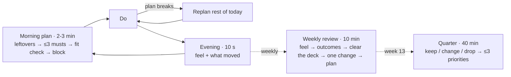

# Usable over comprehensive · How effective people run their day, week and quarter, and what skkil/time should change

_2026-11-01 · Jennifer (PM) · For: founder · Evidence: three new scans (`2026-11-01-high-performer-practices.md`, `-why-planners-fail.md`, `-rituals-and-recovery.md`) on top of `2026-10-23-productivity-methods-evidence.md`_

**Bottom line.** Effective people don't run bigger systems. They make a few decisions ahead of time and clean up within minutes when a plan breaks. Planners get abandoned because upkeep costs more than the planner gives back, and because they show failure louder than progress. skkil/time already has every feature it needs. What it lacks is a **2-minute morning plan**, a **review step that clears the backlog**, and **forgiveness** where it currently shows red counts and resets streaks to zero. Build those three before adding anything else.

Evidence grades used in the appendices: A meta-analysis/RCT · B single peer-reviewed study · C practitioner · D anecdote. No study tests a weekly review or daily-planning ritual as a whole; the evidence covers their parts.

## 1. Effective people decide ahead, keep few priorities, and protect big blocks

| Pattern | Who / evidence | Grade |
|---|---|---|
| **Decide in advance, at three horizons** (quarter → week → day) | Share of planned time was the only CEO behaviour linked to firm performance [secondary: Bandiera et al., JPE 2020, 1,114 CEOs, retrieved 2026-11-01]. Newport plans his week on Monday and blocks each day the evening before | B / C |
| **Few active priorities, held by a fixed limit** | Burkeman's closed list, Shape Up appetites, Franklin's one virtue a week. People can't balance several goals unaided; the nearest deadline wins (Schmidt & DeShon 2007) | B / C |
| **Fixed time, adjustable scope; redraw when the day breaks** | Newport redraws his time blocks; Shape Up gives no extensions. Daily planning predicts daily performance, and contingency plans help on days with many interruptions (Parke et al. 2018) | B / C |
| **Protect contiguous blocks** (an hour or more, not 25-minute slices) | Perlow 1999: 75% of engineers' uninterrupted blocks were ≤1 h. Quiet time worked, then faded once nothing held it in place | B |
| **Judge the day by progress and control, not task count** | Good developer days = the day went as planned (Meyer et al., 5,971 responses). Progress happened on 76% of best days [secondary: Amabile & Kramer via HBS WK, retrieved 2026-11-01] | B |
| **Short daily close-out, weekly reset** | Newport's shutdown; GTD's weekly review (clear → current → creative); Franklin's evening question | C |
| **Let go on purpose** | Disengaging from unreachable goals is linked to lower stress (Wrosch 2003; Riddell 2025 meta-analysis of 235 studies [secondary: Riddell 2025 abstract, retrieved 2026-11-01]) | A / B |

**Myths not to use in copy:** Ivy Lee's $25,000 list, Buffett's 25/5, Seinfeld's "don't break the chain" (he disowns it), Gates/Musk 5-minute slots. All are grade D.

## 2. Planners fail on upkeep, slow capture, and visible failure, not on missing features

1. **Upkeep costs more than the tool gives back.** Almost 80% of tracking devices were abandoned within 2 months (Lazar 2015, n = 17). 11 of 19 people built their own system on paper or Word; GTD was "over-organizing" (Haraty 2012). A self-report prompt was disabled when it took minutes and kept when it took seconds (Meyer 2017).
2. **Capture is slower than a scrap.** Only 14% of to-dos sat in a list, spread over about 11 places per person (Bellotti 2004, n = 8).
3. **Showing failure lowers engagement.** A broken streak cuts later engagement, more so when people blame themselves (Silverman & Barasch 2023, 7 studies). Planned skip days beat both easy and hard goals: up to 40% more days at goal (Sharif & Shu, field RCT; one failed replication).
4. **Reminders get repetition, not habit.** Anchoring a habit to an existing routine builds automaticity; reminders don't (Stawarz 2015).
5. **Tasks rot.** A planned to-do not done within about 2 weeks rarely gets done (Bellotti 2004). Lists grow until something forces a decision.
6. **Data without an action is ignored.** Only 28% opened the retrospective view daily [secondary: Meyer et al. CSCW 2017, retrieved 2026-11-01]. Repeated reflection prompts go stale (Kocielnik 2018).

## 3. The target loop: 3 minutes a day, 10 a week, 40 a quarter

| Ritual | Steps | Target time |
|---|---|---|
| Day | Decide yesterday's leftovers (today / date / someday / drop) → pick ≤3 musts, outcome-linked first → fit check of estimates against free hours → give each must a block or a time of day | 2–5 min plan, ≤10 s check-in |
| Week | Feel → outcomes with evidence → **clear the deck** (inbox, tasks over 14 days old, stale projects) → one change → plan ≤3 outcomes, each with a first task and day | ~10 min, on a day the user picks |
| Quarter | Keep / change / drop for each priority (nothing pre-filled) → ≤3 priorities, each with a first outcome; 5-min check at week 6–7 | 30–45 min |
| Habits | Anchor ("after I ___"), "x of last 14 days", 1–2 planned skip days a week | 1 tap |
| Time | Suggest from blocks and ActivityWatch, user confirms; "track one normal week" as a diagnostic | seconds |

## 4. The current build has the parts but not the flow

Observed in code, 2026-11-01 [primary: code read].

| # | Today | Change | Basis |
|---|---|---|---|
| G1 | **Today is a due-date list.** Overdue tasks sit on top with a red "Reschedule". No pick, no fit check, no blocks. Planner, habits and outcomes live on separate screens (`TodayPage.tsx`) | A "Plan today" header: leftovers → ≤3 musts → fit bar → drag to block. Today shows this week's outcomes, today's blocks and today's habits in one view | B (daily planning, implementation intentions) |
| G2 | **Overdue rolls over silently** and keeps growing | Rollover count on each task; at 3 rollovers, ask reschedule / someday / drop. A "Reset" for tasks overdue more than 7 days, worded as a fresh start | B (tasks rot) + C |
| G3 | **No Someday state** for tasks or projects | Add Someday/Paused. It makes "drop" safe and keeps the active list short | C (GTD, PARA) |
| G4 | **Weekly review never cleans up.** Steps: Feel, Outcomes, The week, Reflect, Plan (`WeekReview.tsx`) | Replace "The week" (a read-only data page, the likeliest drop-off point) with **Clear the deck**. Show the numbers inside Outcomes and Plan | C (GTD) + B (actionable insights) |
| G5 | **An outcome can be carried forever** | After 2 carries, require shrink / re-date / drop | A/B (goal disengagement) |
| G6 | **Habit streaks reset to 0 on a miss** (`habits.rs` streak loop) and the "quit" copy counts toward the streak | "x of last 14 days" plus planned skip days; no reset; anchor field in the habit form | B (broken streaks, reserves, Stawarz) |
| G7 | **Review prompts are fixed** | Rotate the prompt pool; include one about feelings; end every insight with one suggested action | B (Kocielnik, Williams, Meyer) |
| G8 | **The review is labelled "about 5 min"** | Label it "about 10 min" and measure the real time from `week.step` timestamps | Trust |

## 5. Recommendations, ranked

| Rank | What | Who gains | Why it wins | Size (my guess; Emil to confirm) |
|---|---|---|---|---|
| 1 | **Plan today** (G1) | Every daily user; it's the first screen | The most evidence-backed daily step, and the only ritual missing from the loop | M |
| 2 | **Clear the deck + rollover count + Someday** (G2, G3, G4) | Anyone after week 2, which is when lists rot | Stops the decay that makes people quit (failure modes 1 and 5) | M |
| 3 | **Forgiving habits** (G6) | Habit users after their first miss | Cheap; it removes a known engagement drop | S |
| 4 | **Carry limit + quarter keep/change/drop** (G5) | Outcome planners | Turns "letting go" into a feature, not a failure | S |
| 5 | **Suggest-then-confirm time** | Users who don't run a timer | Keeps awareness without upkeep (Choe 2017). Builds on ActivityWatch | M |

Market-value test for #1–#2. **Who gains:** the beachhead (solo builders) and the founder's own Notion + Todoist + Clockify setup. **How much:** replaces 1–2 h a week of Notion upkeep [secondary: vendor blog, retrieved 2026-10-23, low confidence]; the bigger gain is retention past week 2 [assumption]. **Why now:** the feature surface is done; usability is the bottleneck. **Replaces:** Sunsama's daily planning and rollover, Todoist's "Reschedule all". **Cost:** two flows on existing data; no new domain.

**Don't build:** more reminder types, streak counters, a dashboard-style review, or minute-level variance charts. **Don't claim:** that the app makes you more productive. Focus blocks rearrange work rather than add to it (Microsoft CHI 2023), and time management helps wellbeing more than output (Aeon 2021).

## 6. Decisions for you

1. Make **Today the single daily screen** (plan header, blocks, habits, outcomes), so Planner becomes the week-scale view?
2. Replace the review's "The week" step with **Clear the deck**, and add a carry limit of 2?
3. Switch habits from **streaks to "x of last 14 days" plus skip days**?

**Assumptions to validate (own use, 2 weeks):** the morning plan takes ≤3 min on most days; overdue count falls after each review; the weekly review is finished within 7 days at least 3 weeks in 4.

**Next step:** on a yes to 1–3, I write the spec (`spec-daily-loop-2026-11-xx.md`) and a design brief for Rebecca.

## Gaps

- No trial of weekly reviews, daily-planning rituals, night-before vs morning planning, or "to-do bankruptcy".
- No peer-reviewed data on to-do app abandonment rates.
- Secondary-only figures: Amabile's progress-day share, Porter & Nohria's CEO time shares, Riddell 2025 pooled effects, Parke 2018 effect sizes.
- The caps (3 outcomes, 3 projects in progress, 14-day rot, 3 rollovers) are practitioner or single-study numbers. Treat them as defaults the user can change.
