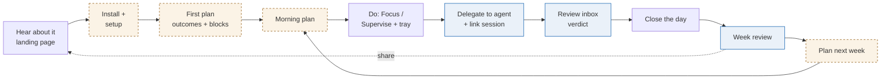

# skkil-time · Design improvements along the user's flow

> **Update 2026-10-23:** founder confirmed the planner is required; Sunsama is the benchmark to beat. Parity list and build order (M1 planner + reality, M2 agent layer) in `REEVALUATION-SUNSAMA.md`. Items #6 and #7 move to P0.

_2026-10-23 · Jennifer (PM) · Input: `.design/` (DESIGN.md, 14 mocks), spec v1, competitor landscape 2026-10-23 · For: founder, Rebecca, Emil_

**Bottom line.** The daily loop (Today → Focus → Review inbox → Close the day → Week review) is well designed and on-thesis. The weak points sit at the two ends of the flow, where products like this usually lose people: **getting started** (no first-run flow; the first honest number arrives at 17:45 on day 1 at the earliest) and **turning the mirror into a change** (the weekly review shows 12+ numbers but asks for no next step). There is also one correctness bug that breaks the core promise: Claude Code's `Stop` hook fires after every turn, not when a task is finished. **Ask:** approve the five "Do now" items for the next design pass and the Phase 0 landing page.

**For the founder's own use (§6):** the design can't yet replace your Notion + Todoist + Clockify setup. It lacks a quarter layer, rough day slots, time by project, offline focus, habits, reflection prompts and dark mode. Fix those first, because dogfooding is Phase 0's step 1.

## 1. The flow, and where it breaks

Dashed amber = no screen exists. Blue = screen exists, flow has a hole.

| Stage | What the mocks show | What's missing |
|---|---|---|
| Install + setup | Settings (hooks diff, MCP tokens), "Plan one block to start" empty state | No onboarding. ActivityWatch, browser extension, hooks, calendar and first outcomes are each set up somewhere else. The empty state says "Capture is already running", which assumes ActivityWatch is installed |
| First plan / plan next week | Week review ends "drag tasks into Monday's blocks" | No week-planning screen. The highest-effort ritual has no guided surface |
| Morning plan | A Today row named "Inbox, plan the day" | No guided daily start (Sunsama's core ritual), no view of yesterday's resume notes and overnight drafts |
| Delegate + link | Board "Delegated" column; "Unlinked sessions · Assign" in Settings | How a task becomes delegated isn't drawn. Linking sessions, a core daily action, is hidden in Settings |
| Review inbox | Expected result, session metadata, verdict | Nothing to verify *with*: no branch, commit or PR link |
| Week review | Outcomes, felt vs shipped, 6 agent metrics, estimates | No "so what": no single insight, no experiment for next week |

## 2. Do now (before or with the Phase 0 landing page)

### 2.1 Fix the draft trigger: `Stop` is not "done"

**Observation.** REQ-AG-01 moves a task to Draft on `Stop` or `SessionEnd`. Claude Code's `Stop` hook runs every time the agent finishes a response [secondary: Claude Code hooks docs, retrieved before 2026-10; Emil to confirm]. A single delegated task can fire it dozens of times, including at every question the agent asks you.
**Interpretation.** As specced, the Review inbox fills with false drafts, or drafts appear while the agent is waiting on a question. "Nothing counts until you say so" stops being trustworthy, and that is the product's main promise.
**Recommendation.** Draft = (a) the agent calls `mark_draft_ready` over MCP, (b) the user runs `/skkil done` or clicks "Draft ready", or (c) `Stop` followed by N minutes of no user input in that session, shown as "Probably done?" and not as a Draft. Emil to size; also ask whether Claude Code's OpenTelemetry export gives cleaner session signals than hooks.

### 2.2 Design the first run around one "aha" in under 5 minutes

**Observation.** Value is delayed: the first Close the day is ~8 h after install, the first week review up to 7 days. Setup touches 4-5 separate systems. Planners die around week 2 [anecdote: ADHD planner essay, competitor scan]; this product needs the user to reach week 1.
**Recommendation.** A 4-step onboarding with a payoff at the end:
1. **Capture check:** detect ActivityWatch; if missing, one-click install or "skip, agents only".
2. **Agents:** the existing hooks-diff card, moved here.
3. **This week:** "It's Thursday. Pick 1 outcome for the rest of the week." (not 3)
4. **Instant mirror:** "Your last 7 days, as they happened": git commits per repo, plus ActivityWatch history if the user had it. No plan to compare against yet, so show *reality only* and ask "Was this the week you meant?" That's the hook for planning tomorrow.

Reading Claude Code's local session files for timestamps would give agent history on day 1, but those files contain prompts. **Don't do it** without a privacy review by Sasha (POL-PRIV-02). Git history is enough for the first aha.

| Market-value test | |
|---|---|
| Who gains | Every new install; activation decides whether the 7.5k-11k installs needed for $1K MRR [estimate: strategy-2026-10-18 funnel] turn into reviewers |
| How much | Unknown; no setup funnel is instrumented. [assumption: setup with ≥4 external steps loses a large share; measure it] |
| Why now | Before the private beta, so the first 30 users (spec §13 Phase 1 gate) don't churn at setup |
| Replaces | Today's blank "Plan one block to start" |
| Cost | Rebecca: 4 screens. Emil: AW detection, git log read. [Jennifer's guess: S-M] |

Add setup-funnel events (`setup_step_completed`) to §10. Opt-in analytics means the funnel is otherwise invisible.

### 2.3 Put delegation and session linking where the user already is

**Observation.** The persona lives in 2-3 terminals [DESIGN.md §1]. Capture and linking happen in the app's right rail, the tray and Settings. Unlinked sessions sit under Settings → Agents.
**Recommendation.**
- A `skkil` CLI and a Claude Code slash command: `skkil add "Retry docs ~30m #webhooks"`, `/skkil link` (links this session to a task, offers the expected-result line), `/skkil done`. Cheaper than MCP for the user and works without an agent.
- Unlinked sessions appear **inline in the Supervise row** on Today ("ledgerline/jobs, no task · Assign"), not in Settings.
- A global quick-capture hotkey (Linux/macOS) that opens the capture field over any window.

This stays inside the non-goals: we don't launch or host agents, we only label them.

### 2.4 End the weekly review with one insight and one experiment

**Observation.** The Week mock shows outcomes, a felt-vs-shipped chart, 6 agent metrics, a timeline and an estimates table, then asks for next week's outcomes. The Phase 0 gate is "a number changes a habit", but no screen asks for a habit.
**Interpretation.** A mirror with no next step is a report. Reports get read twice and dropped. It also raises the shame risk (§14): many numbers, no way to act on them.
**Recommendation.** Lead the review with **one** sentence the data supports ("With 4 agents running, two waited nearly an hour. With 3 or fewer, your median wait was 9 min."), then offer **one experiment** for next week chosen by the user: "Max 3 agents", "No agents in focus blocks", "Review inbox before 12:00". Next week's review opens with "You tried max 3 agents: here's what changed." Detailed metrics move below a fold.
This is the differentiator no incumbent has: a planner that tests your own rules with your own data, with no AI deciding anything. **Who gains:** every week-2+ user. **Cost:** one card plus an experiment object [guess: S].

### 2.5 Don't paywall the activation path

**Observation.** Codex and Cursor adapters are Plus-only (§11, Settings mock). Price and paywalls are the #1 complaint in planner reviews: 295 of 710 1-2★ reviews [secondary: App Store scan, 2026-10-23]. Structured's top complaint is a core feature behind the paywall.
**Interpretation.** A Cursor-only or Codex-only builder installs, finds their agent locked, and gets no value from the free tier. They never reach the review that would sell Plus.
**Recommendation.** All agent adapters free. Plus charges for what grows with use: sync, unlimited history, export/share card, mobile, calendar write. Revisit if Phase 0 deposits show adapters are what people pay for.

## 3. Next (design pass after Phase 0)

| # | Improvement | Flow stage | Why | Evidence |
|---|---|---|---|---|
| 6 | **Guided morning plan** (2 min): carry-overs with resume notes, drafts that arrived overnight, today's calendar, then drop into blocks | Morning plan | Sunsama's core ritual is the category baseline; ours is a row label | [secondary: competitor scan, 2026-10-23] |
| 7 | **Week-planning screen**: outcomes on the left, week grid on the right, backlog sorted outcome-first | Plan next week | The weekly review hands off to a screen that doesn't exist | mocks |
| 8 | **Git evidence on drafts**: branch, commit count, PR link, CI status (metadata only) and an "Open PR" button. Move REQ-AG-08 from P2 to P1 | Review inbox | For code, the PR *is* the evidence. "Open folder in VS Code" makes the user hunt for it | [assumption: most beachhead drafts are code] |
| 9 | **Share card as the growth loop**: "Week 43 · 2 of 3 outcomes · 9 of 13 agent drafts accepted", user picks the fields | Week review → landing page | Build-in-public is the beachhead's native channel; it costs nothing per install. Public reporting also strengthens goal effects | [secondary: Harkin 2016, spec §4] |
| 10 | **GitHub Issues import** before Todoist import | First plan | Solo builders' tasks live in issues more than in Todoist | [assumption; ask in Phase 0 interviews] |
| 11 | **"What we stored today" inspector** in Your data: the raw rows for one session and one hour | Setup, trust | A local-first privacy promise is more believable when the user can see the stored rows | [assumption] |

## 4. Fix or cut

| Item | Problem | Recommendation |
|---|---|---|
| **Board** (6 columns) | Repeats Today + Review inbox + week. It adds design and engineering scope to a product already flagged "scope too large" (§14) | Cut from P0. Keep the state model; show Delegated/Draft counts on Today |
| **Close the day "Carried to tomorrow"** | Shows "Fri 09:00 focus" with no confirm step. POL-PLAN-04 says the app never moves blocks on its own | Show it as a suggestion with "Keep" / "Back to backlog" |
| **Close-the-day reminder at 17:45** | Solo builders often work evenings; a fixed time misses them | Default to "after your last block" |
| **"On plan here" allow-list per focus block** | Setup cost every block | Prefill from the outcome's past blocks. "It's part of the work" already adds to it |
| **GNOME Wayland is P1** (REQ-CAP-09) | Ubuntu's default desktop. A Linux-first product without it blocks a large share of its Linux users at setup | Decide the P0 platform honestly: macOS + KDE/X11, or pull GNOME forward. Emil to estimate |
| **Felt rating labels** "Rough / Meh" | Fine. Keep the one-tap flow | No change |

## 5. What I'd not add

- **Phone notifications for waiting agents.** Tempting, but platform-owned (Claude Code, Codex app, Cursor) and listed as rejected (standalone notifier, 2026-10-18).
- **AI summary of the week.** The one-insight card (2.4) is rule-based from our own numbers. An LLM summary brings in "AI for the sake of AI", 16% of 1-2★ reviews [secondary: App Store scan, 2026-10-23].
- **More metrics.** The week review already has more than a user can act on.

## 6. The founder's own setup must work first, with zero double entry

**Bottom line.** Your current setup (Notion + Todoist + Clockify + Opal) already *is* the Plan → Do → Review loop, but done by hand across four tools. The design covers about half of it. It is missing the **quarter layer**, **rough parts of the day**, **time by project**, **offline focus**, **habits**, **written reflection** and **dark mode / Hangul**. Agents play no part in your current tracking, so the non-agent loop has to be complete on its own. That's also the spec's second segment, so it's worth doing anyway.

### 6.1 What you do today, and what replaces it

Observed from your screenshots [primary: founder's own setup, 2026-10-23].

| You do today | Tool | Manual work | skkil-time should | In the design? |
|---|---|---|---|---|
| Quarter page: 13 weeks (Mon start, "Week 1-13"), 3 yearly priorities | Notion | Create quarter and week pages | Quarter object with ≤3 priorities. Weekly outcomes link to one. Weeks numbered inside the quarter ("Q4 · Week 4") | **No.** Only ISO weeks + weekly outcomes |
| Week list: status (完/行), Focused Time (18 → 35 → 40 h) | Notion | Copy the hours from Clockify each week | Auto-filled week row: focused hours, outcomes achieved, closed days. A quarter strip of 13 bars | **No.** Week review has no headline hours and no quarter trend |
| Weekly priorities + "1% Improvement" | Notion | Type each week | Weekly outcomes (exists) + the experiment from 2.4, phrased as your "1% improvement" | Partly |
| Daily check-in: 朝/午/夜 plan, checked off | Notion | Write the plan, then also schedule it in Todoist | A day planned in **rough slots** (morning / afternoon / evening) *or* exact blocks; both count as a "when" | **No.** Rough slots only allowed for personal blocks (POL-PLAN-03) |
| 省: one reflection line per day | Notion | Type nightly | "Anything to add?" in Close the day (exists). Show the 7 lines in the week review | Partly. Lines aren't shown in the week |
| Habit tracker: 7-day O/X grid | Notion | Mark daily | 1-3 yes/no habits asked in Close the day; a Mon-Sun grid in the week review. No streak counter (DESIGN.md says no streaks) | **No** |
| Weekly reflection: what worked / fell short + why / one change | Notion | Type weekly | Three short prompts in the week review, each with the data next to it ("Fell short: Wed had 2h 10m elsewhere") | **No.** Only outcome status |
| Timed blocks; recurring classes; all-day deadlines (applications) | Todoist "Blocks" filter | Create blocks, recurring tasks | Recurring blocks (class schedule), deadlines as a strip rather than all-day blocks | **No recurrence** in mocks |
| Projects/areas: courses, STiTy, CLIP, Life | Todoist + Clockify | Same list kept in two tools | One **project/area** field on tasks and blocks; time by project in the week review | **No.** Only outcomes |
| Start/stop timer per task, tagged by course + quarter | Clockify | Start, stop, label; a 1h55m "(no description)" entry got lost | Block start = timer. Passive capture fills the actual time. Unlabelled time is offered for one-click assignment at day close | Partly (Focus screen) |
| Block distracting apps | Opal (phone) | Set schedules | Keep Opal for the phone. On desktop, an optional **hard block** of off-plan domains during focus blocks via the browser extension | **No.** Nudge only |

Manual copying already drifts. Clockify shows **42h 11m** for Oct 12-18, and Notion records **40** for Week 3 [primary: screenshots]. That's either rounding or a judgment call. Either way, the number you track isn't defined anywhere.

### 6.2 Changes, in priority order for your own use

1. **Offline focus counts.** Exam prep happens on paper, an iPad or a printed PDF. Passive capture sees AFK and would show that study time as "Elsewhere" or idle. That's wrong, and it's discouraging. In a focus block: if the computer is idle, ask once at the end: "Were you on this away from the screen?" Yes means it counts as focus, marked "self-reported". Without this, your main number (focused hours) is wrong in exam weeks.
2. **Define "focused hours" and make it the week's headline.** Focused hours = single-tasked minutes in focus blocks + confirmed offline focus. Show it at the top of the week review and as a 13-week quarter strip. This replaces the Clockify → Notion copy.
3. **Quarter layer.** Quarter → ≤3 priorities → ≤3 weekly outcomes → day. Small data change, one header on Today and the week review.
4. **Rough slots are a valid "when".** Allow 朝/午/夜 (morning / afternoon / evening) for any task, not only personal ones. The if-then evidence needs a when; "this afternoon" is a when [assumption: weaker than an exact time, but better than a date only (Milkman 2011 tested date+time)]. Keep exact blocks for classes and focus.
5. **Projects/areas + recurring blocks.** Needed to replace Todoist's filter and Clockify's project totals. Seed both from Todoist through its API. **Move Todoist import (REQ-PLAN-10) to P0 for founder use.** Keep Todoist on the phone for capture until the mobile app exists (P2).
6. **Habits and reflection in the existing rituals,** not as new screens. Close the day: habits as yes/no after the felt rating, plus the 省 line. Week review: the habit grid, the 7 daily lines, then the three prompts and the 1% change.
7. **Dark theme and Hangul.** You work in dark Notion, dark Todoist and dark terminals. The design is light-only (DESIGN.md §3) and Red Hat has no Hangul glyphs, so titles like "한국능률협회…" and "더트라이브…" fall back to a random font. Add dark tokens and a Korean fallback such as Pretendard. Optionally, allow 月火水 / 朝午夜 / 完行 labels as a display choice.
8. **Desktop hard block (optional).** You already chose blocking with Opal, so offer it as an opt-in on top of the nudge. That's a change to the spec's "awareness before blocking" position for users who opt in; it isn't the default.

**Don't build:** a phone blocker or screen-time import (Opal does it; iOS limits APIs; rejected 2026-10-18), or a Notion-style free-form page editor. Free text stays one line a day plus three weekly prompts.

**Personal success test (2 weeks, your own use):** you stop opening Clockify and Notion. Notion is replaced, not integrated. If you still open either, the replacement isn't done.

## Decisions needed

1. Approve 2.1-2.5 for the next design and spec pass (founder).
1a. Approve §6 as the definition of "founder can dogfood" (founder): quarter layer, rough slots, projects, offline focus, habits, reflection prompts, dark theme, Todoist import in P0.
2. Draft-trigger redesign and OTel question (Emil).
3. Adapter pricing change in §11 (founder; affects the landing-page price test, OQ-6).

## Assumptions to validate (add to Phase 0 interviews)

- Builders would run a `skkil` CLI or slash command to link sessions (ask: "How would you tell the app this session is task X?").
- Most delegated drafts are code with a branch or PR.
- Users set an experiment and check it the next week (own-use prototype, 3 weeks).

## Gaps

- No setup-funnel or retention data: everything about activation is an assumption until the beta.
- I didn't verify current Claude Code hook semantics in this session beyond prior knowledge; Emil should confirm 2.1 before the spec changes.
- MobileCapture and MobileInbox mocks were not reviewed in detail (P2).

**Next step:** Rebecca drafts the 4-step onboarding (2.2) and the insight + experiment card (2.4); Emil answers 2.1.
